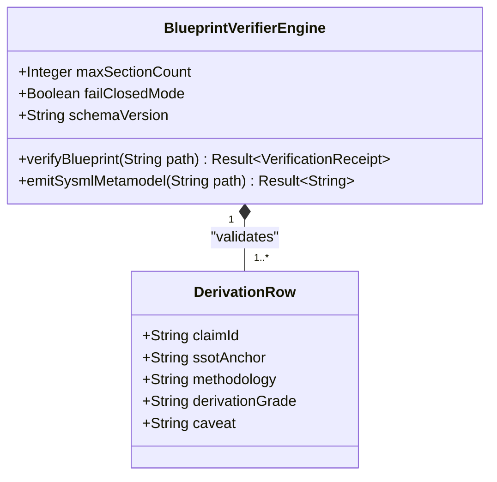
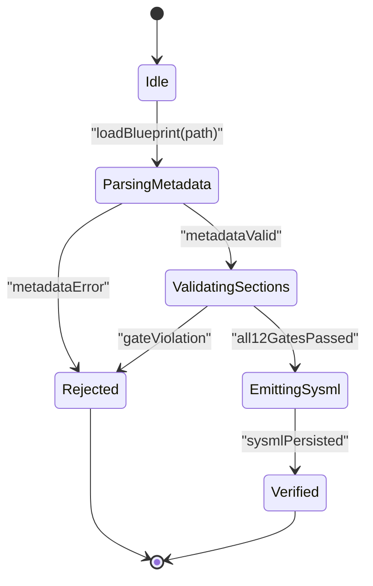

# Specification Blueprint Engineering

## 1. Reference

### 1.1 Architecture & Input Parameters
Context-isolated subagent receives five mandatory input parameters:
- `BLUEPRINT_PATH`: Target repository path (`docs/designs/blueprint-XX-<slug>.md`). Ephemeral paths (`/tmp/`, `<appDataDir>`) are strictly forbidden per `.pipeline/constitution.md:155`.
- `REQ_ID`: Primary requirement identifier (`REQ-XXXX`).
- `TARGET_CRATES`: Comma-separated list of target Rust workspace crates under `crates/` (e.g., `crates/deap-core, crates/verify-baseline`).
- `TRACKER_ISSUES`: Authoritative GitHub issue references (`#ID` or comma-separated `#ID1, #ID2`).
- `REPO`: Target GitHub repository slug (`<owner>/<repo>`).

The subagent reads this `SKILL.md` and `.pipeline/constitution.md`, extracts the deterministic fact base from the codebase and defect/issue artifacts, authors a single blueprint file at `BLUEPRINT_PATH` adhering strictly to the Mandatory 8-Part Skeleton, and invokes `./target/release/verify-baseline check-blueprint` to mechanically enforce all 12 verification gates, synthesize/persist the in-repo `.sysml` metamodel fragment, optionally publish/synchronize the GitHub SSOT tracker issue, and return a 5-line completion receipt to the coordinator.

### 1.2 When to Use
Use when translating architectural requirements, clustered defect dossiers (`.pipeline/defects/*.md`), or complex multi-crate subsystem specifications into a formal, verifiable engineering design blueprint under `docs/designs/blueprint-XX-<slug>.md` prior to or during feature-driven implementation.

### 1.3 Derivation-Annotation Contract
Per `.pipeline/constitution.md:209` (Step 1.5 STPA/FMECA Derivation-Annotation Contract), all analytical claims and architectural decisions in a blueprint are engineering derivatives of the Single Source of Truth (SSOT) fact base. Every row in the Section 1 Derivation-Annotation table MUST carry five non-empty columns:
1. **Claim / Requirement**: The specific architectural requirement, invariant, or behavioral guarantee (**REQ-XXXX**, **SC-XX**).
2. **SSOT Input Anchor (file:line / #ID)**: Verbatim repository `file:line` range, `.pipeline/defects/<name>.md` reference, or `#ID` tracker anchor (or explicit silent source set).
3. **Methodology Citation**: Formal engineering methodology governing the derivation (e.g., `Leveson STPA`, `MIL-STD-1629A / SAE ARP4761`, `ISO/IEC/IEEE 29148:2018`, `Design by Contract (DbC)`).
4. **Derivation Grade (Directly Evidenced / Analytically Derived / Declared Assumption)**: Must match one of the three exact canonical grades:
   - `Directly Evidenced`
   - `Analytically Derived`
   - `Declared Assumption`
5. **Caveat / Downstream Impact**: Mandatory constraint record detailing boundary assumptions, silent source handling, or downstream crate impact.

### 1.4 UML & Mermaid Formatting Rules (Rules E1–E5)
All diagrams in Section 3 (`## 3. UML & Behavioral Topology`) MUST use fenced ```` ```mermaid ```` blocks (`classDiagram`, `stateDiagram-v2`, `sequenceDiagram`, `flowchart TD`, and/or `graph TD`) and strictly obey Rules E1–E5:
- **Rule E1 (Valid Header on Line 1)**: The first non-comment line inside every ```` ```mermaid ```` block MUST declare a valid diagram type header (`classDiagram`, `stateDiagram-v2`, `sequenceDiagram`, `flowchart TD`, `graph TD`).
- **Rule E2 (Quoted Special Characters)**: Node labels, state descriptions, and subgraph titles containing special characters (`/`, `:`, `()`, `[]`, spaces, or hyphens) MUST be enclosed in double quotes.
- **Rule E3 (Zero Unquoted Angle Brackets)**: Unquoted `<` and `>` characters are strictly forbidden across all diagram types. Generic types in `classDiagram` MUST use tilde syntax (`~T~`) or quoted strings.
- **Rule E4 (Zero Curly Braces or Secondary Colons in Class Members)**: Curly braces `{}` and secondary colons (`:`) are strictly prohibited inside `classDiagram` member strings. Use standard method/field spacing (`+ReturnType methodName(Type arg)`).
- **Rule E5 (Matching Closing Fences)**: Every ```` ```mermaid ```` block MUST terminate with a matching closing fence (```` ``` ````) on its own isolated line. ASCII art diagrams are strictly forbidden.

### 1.5 Formal Mathematics & Governance Invariants
- **Universal LaTeX & KaTeX Rules (Check 27)**: All multi-line equations in Section 4 (`## 4. Formal Mathematical & Safety Constraints`) MUST use isolated `$$` display math delimiters on their own lines wrapping `\begin{aligned} ... \end{aligned}`. Top-level `\begin{align}` is strictly forbidden. Non-mathematical alphanumeric identifiers (**REQ-XXXX**, **BP-XX**, **SC-01**, **AC-01**, **H-1**, **UCA-1**) MUST NOT be wrapped in inline math delimiters; use bold (`**REQ-XXXX**`) or inline code spans instead.
- **Zero Regex Invariant (Check 34)**: Proposed Rust contracts in Section 6 (`## 6. Proposed Deterministic Implementation Contract`) MUST NOT reference or import the `regex` crate. All parsing and validation contracts MUST use deterministic linear slice, char, or token scanning exclusively.
- **Domain Cleanliness Invariant (Check 19)**: Upstream compiler blueprints and contracts targeting `crates/*` MUST remain 100% domain-agnostic with zero hardcoded customer domain concepts.
- **Strict Clippy Denials (`[workspace.lints.clippy]`)**: All Rust code blocks in Section 6 MUST comply with workspace `forbid` lints — zero `.unwrap()`, zero `.expect()`, zero `panic!`, and zero raw `[a..b]` slice indexing (use `.get(a..b)`, pattern matching, and `Result<T, E>` propagation).
- **Commit Message Non-Closure Invariant**: Never use auto-closing keywords (`fix`, `fixes`, `fixed`, `close`, `closes`, `closed`, `resolve`, `resolves`, `resolved` preceding `#<id>`). Use neutral citations `(#<id>)` or `(refs #<id>)` exclusively (`.pipeline/constitution.md:279`).

---

## 2. Mandatory 8-Part Skeleton

Every blueprint written to `docs/designs/blueprint-XX-<slug>.md` MUST match the following 8-part skeleton character-for-character in table headers and H2/H3 section headings, starting directly on Line 1 with the CommonMark Two-Column Metadata Table (never prepend a leading `# ` H1 header or YAML frontmatter block before Line 1):

### Part 1 — Lines 1–11 (CommonMark Two-Column Metadata Table)
Lines 1–10 MUST consist of the exact two-column CommonMark metadata table declaring the 8 mandatory attributes (`Blueprint ID`, `Requirement ID`, `Title`, `Status`, `Target Crates`, `Tracked Issues`, `Generation Mode`, and `Specification Source`), followed by an empty separator line on Line 11:

```markdown
| Attribute | Specification Detail |
| :--- | :--- |
| **Blueprint ID** | `BP-XX` |
| **Requirement ID** | `REQ-XXXX` |
| **Title** | [Concise Engineering Blueprint Title] |
| **Status** | `Draft` |
| **Target Crates** | `crates/<crate-name>` |
| **Tracked Issues** | `#ID` |
| **Generation Mode** | `subagent` |
| **Specification Source** | `<file:line / #ID>` |
```

### Part 2 — `## 1. Executive Summary & Derivation-Annotation Contract`

```markdown
## 1. Executive Summary & Derivation-Annotation Contract

[Concise architectural summary defining problem statement, system boundary, and deterministic verification scope.]

| Claim / Requirement | SSOT Input Anchor (file:line / #ID) | Methodology Citation | Derivation Grade (Directly Evidenced / Analytically Derived / Declared Assumption) | Caveat / Downstream Impact |
| :--- | :--- | :--- | :--- | :--- |
| **REQ-XXXX**: [Primary architectural claim] | `crates/deap-core/src/lib.rs:1-50` / `#100` | `ISO/IEC/IEEE 29148:2018` | `Directly Evidenced` | Enforced across target workspace crates without backward-compatibility shims. |
| **SC-01**: [Fail-closed validation constraint] | `.pipeline/constitution.md:170-192` | `Leveson STPA` | `Analytically Derived` | Halts pipeline execution with non-zero status on any malformed AST node. |
```

### Part 3 — `## 2. Structural Component Metamodel`
Contains one or more `### Component: <PascalCaseIdentifier>` subsections. Every component subsection MUST contain both the 5-column properties table (`| Attribute | Type | Default | Unit | Description |` using valid SysML v2 types `Integer`, `Boolean`, `Real`, `String`, or declared `PascalCase` classifier names) and the 5-column ports/interfaces table (`| Port | Direction | Type | Protocol | Description |` using `in`, `out`, or `inout`):

```markdown
## 2. Structural Component Metamodel

### Component: BlueprintVerifierEngine

| Attribute | Type | Default | Unit | Description |
| :--- | :--- | :--- | :--- | :--- |
| `maxSectionCount` | `Integer` | `8` | `count` | Mandatory top-level structural part count enforced by the parser. |
| `failClosedMode` | `Boolean` | `true` | `flag` | Rejects partial or unverified blueprint payloads when enabled. |
| `schemaVersion` | `String` | `"1.0"` | `semver` | Canonical blueprint schema specification version identifier. |

| Port | Direction | Type | Protocol | Description |
| :--- | :--- | :--- | :--- | :--- |
| `markdownInputPort` | `in` | `String` | `FileStream` | Receives raw CommonMark blueprint source from repository disk. |
| `sysmlAstOutputPort` | `out` | `String` | `SysmlV2Text` | Emits deterministic SysML v2 metamodel artifact to schema storage. |
| `trackerSyncPort` | `inout` | `String` | `GitHubCliJson` | Publishes and verifies closed-loop issue payload parity. |
```

### Part 4 — `## 3. UML & Behavioral Topology`
Contains one or more fenced ```` ```mermaid ```` diagrams (`classDiagram`, `stateDiagram-v2`, and/or `sequenceDiagram`) strictly compliant with Rules E1–E5:

````markdown
## 3. UML & Behavioral Topology




````

### Part 5 — `## 4. Formal Mathematical & Safety Constraints`
Contains isolated `$$` display math blocks using `\begin{aligned} ... \end{aligned}` and explicit constraint definitions (with zero inline math delimiters around alphanumeric IDs such as **REQ-XXXX** or **SC-01**):

```markdown
## 4. Formal Mathematical & Safety Constraints

- **SC-01 (Total Gate Soundness Constraint)**: A blueprint artifact under **REQ-XXXX** is admissible if and only if all 12 mechanical verification predicates evaluate to 1 (true) over the parsed document AST:

$$
\begin{aligned}
\text{ValidBlueprint}(D) &\iff \prod_{k=1}^{12} G_k(D) = 1 \\
\text{Completeness}(T_{\text{deriv}}) &\iff \forall r \in T_{\text{deriv}}, \quad \lvert \text{cells}(r) \rvert = 5 \land \forall c \in \text{cells}(r), \quad \text{len}(\text{trim}(c)) > 0
\end{aligned}
$$

- **SC-02 (Fail-Closed Termination Invariant)**: Whenever any gate predicate evaluates to `G_k(D) = 0`, the verifier halts before persistence or tracker publication and returns a structured diagnostic error.
```

### Part 6 — `## 5. Acceptance Criteria & Verification Matrix`
Contains at least 5 numbered criteria (`### AC-01: ...` through `### AC-05: ...`) using the canonical 3-layer Given-When-Then BDD format (`- **Given**:`, `- **When**:`, `- **Then**:`), including mandatory negative/fail-closed scenarios, plus an explicit `<!-- test-target: crates/<crate>/tests/<file>.rs -->` HTML comment and matching `- **Test-Target**: \`crates/<crate>/tests/<file>.rs\`` field:

```markdown
## 5. Acceptance Criteria & Verification Matrix

<!-- test-target: crates/verify-baseline/tests/blueprint_gate_tests.rs -->

- **Test-Target**: `crates/verify-baseline/tests/blueprint_gate_tests.rs`

### AC-01: Valid 8-Part Blueprint Passes All 12 Verification Gates
- **Given**: A repository blueprint file at `docs/designs/blueprint-01-example.md` containing a complete Lines 1–11 metadata table and all 7 H2 sections with valid tables, Mermaid blocks, math blocks, 5 BDD criteria, and safe Rust contracts.
- **When**: `./target/release/verify-baseline check-blueprint docs/designs/blueprint-01-example.md --dry-run` is invoked.
- **Then**: All 12 mechanical gates pass, the corresponding `.sysml` metamodel is synthesized cleanly, and the command exits with status code 0.

### AC-02: Fail-Closed Rejection on Ephemeral or Non-Repository Paths
- **Given**: A blueprint file path residing outside `docs/designs/` or inside an ephemeral `/tmp/` directory.
- **When**: `./target/release/verify-baseline check-blueprint` is invoked on the target path.
- **Then**: Gate 1 rejects the path immediately with a non-zero exit code and emits a path governance violation diagnostic.

### AC-03: Fail-Closed Rejection on Invalid Derivation Grade
- **Given**: A blueprint whose Section 1 Derivation-Annotation table contains a row where Column 4 is not `Directly Evidenced`, `Analytically Derived`, or `Declared Assumption`.
- **When**: The Section 1 table parser evaluates the derivation contract rows.
- **Then**: Gate 4 fails closed and reports the offending row index and invalid derivation grade value.

### AC-04: Fail-Closed Rejection on Unquoted Mermaid Special Characters or Forbidden Math Delimiters
- **Given**: A blueprint containing unquoted angle brackets in a `classDiagram` member or alphanumeric identifiers wrapped in inline math delimiters in Section 4.
- **When**: Gates 6 and 7 inspect the Section 3 Mermaid blocks and Section 4 mathematical constraints.
- **Then**: The verifier rejects the document with an explicit line-numbered syntax diagnostic.

### AC-05: Fail-Closed Rejection on Unsafe Rust Contract Tokens
- **Given**: A blueprint whose Section 6 `rust` contract block contains forbidden clippy tokens or banned crate references.
- **When**: Gate 9 scans the fenced Rust implementation contract block using linear token scanning.
- **Then**: The verifier halts with a non-zero exit code identifying the prohibited token.
```

### Part 7 — `## 6. Proposed Deterministic Implementation Contract`
Contains fenced ```` ```rust ```` type signatures and trait/function contracts strictly satisfying Check 34 (zero `regex` crate usage; linear slice/char/token scanning only), Check 19 (zero hardcoded domain tokens), and `[workspace.lints.clippy]` `"forbid"` (zero `.unwrap()`, `.expect()`, `panic!`, or raw `[a..b]` slice indexing):

````markdown
## 6. Proposed Deterministic Implementation Contract

```rust
use std::path::Path;

#[derive(Debug, Clone, PartialEq, Eq)]
pub enum DerivationGrade {
    DirectlyEvidenced,
    AnalyticallyDerived,
    DeclaredAssumption,
}

#[derive(Debug, Clone, PartialEq, Eq)]
pub struct BlueprintMetadata {
    pub blueprint_id: String,
    pub requirement_id: String,
    pub title: String,
    pub status: String,
    pub target_crates: Vec<String>,
    pub tracked_issues: Vec<String>,
    pub generation_mode: String,
    pub specification_source: String,
}

#[derive(Debug, Clone, PartialEq, Eq)]
pub struct BlueprintVerificationReceipt {
    pub blueprint_path: String,
    pub sysml_output_path: String,
    pub passed_gates: usize,
    pub tracker_url: Option<String>,
}

pub fn parse_derivation_grade(cell: &str) -> Result<DerivationGrade, String> {
    match cell.trim() {
        "Directly Evidenced" => Ok(DerivationGrade::DirectlyEvidenced),
        "Analytically Derived" => Ok(DerivationGrade::AnalyticallyDerived),
        "Declared Assumption" => Ok(DerivationGrade::DeclaredAssumption),
        other => Err(format!("invalid derivation grade: {other}")),
    }
}

pub fn verify_blueprint_contract(path: &Path, source: &str) -> Result<BlueprintVerificationReceipt, String> {
    if source.trim().is_empty() {
        return Err("blueprint source must not be empty".to_owned());
    }
    let display_path = path.display().to_string();
    Ok(BlueprintVerificationReceipt {
        blueprint_path: display_path,
        sysml_output_path: String::from("docs/designs/blueprint-01-example.sysml"),
        passed_gates: 12,
        tracker_url: None,
    })
}
```
````

### Part 8 — `## 7. Source References`
Contains verbatim intra-repository `file:line` references, defect dossier paths (`.pipeline/defects/*.md`), and GitHub issue URLs/identifiers:

```markdown
## 7. Source References

- **Governance Constitution**: `.pipeline/constitution.md:151-212` (Repository Artifact Management Mandate & Step 1.5 Derivation-Annotation Contract)
- **Active Rules Bundle**: `.pipeline/ACTIVE_RULES_BUNDLE.md:1-120` (Checks 13B, 19, 27, 30, 34)
- **Target Crates**: `crates/deap-core/src/lib.rs:1-40`, `crates/verify-baseline/src/main.rs:1-80`
- **Tracked Issues**: `#100`
```

---

## 3. 3-Stage Protocol & 12-Gate Verification Reference

### Stage 1: Deterministic Fact-Base Extraction
1. Read `skills/spec-blueprint-engineering/SKILL.md` and `.pipeline/constitution.md` in full.
2. Inspect the authoritative source AST (`deap_core::source_ast` / target Rust crate source files under `TARGET_CRATES`), linked defect dossiers under `.pipeline/defects/*.md`, GitHub tracker issues (`TRACKER_ISSUES`), and normative specification clauses.
3. Verify exact `file:line` anchors for every claim, component attribute, port direction, state transition, mathematical invariant, and Rust signature before drafting. Never invent unanchored claims; where source documents are silent, record `Declared Assumption` with an explicit caveat in Section 1.

### Stage 2: Contract-Bounded Single-Item Agentic Authoring
1. Author exactly one blueprint file per subagent dispatch at `BLUEPRINT_PATH` (`docs/designs/blueprint-XX-<slug>.md`).
2. Populate all 8 parts character-for-character:
   - **Part 1 (Lines 1–11)**: Two-column CommonMark metadata table (`| Attribute | Specification Detail |`) with `Generation Mode` set to `` `subagent` ``.
   - **Part 2 (`## 1. Executive Summary & Derivation-Annotation Contract`)**: Summary prose plus the 5-column Derivation-Annotation table.
   - **Part 3 (`## 2. Structural Component Metamodel`)**: `### Component: <PascalCaseIdentifier>` blocks with 5-column properties and ports tables.
   - **Part 4 (`## 3. UML & Behavioral Topology`)**: Rules E1–E5 compliant ```` ```mermaid ```` diagrams.
   - **Part 5 (`## 4. Formal Mathematical & Safety Constraints`)**: Check 27 compliant `$$` `\begin{aligned} ... \end{aligned}` blocks and bold requirement/constraint IDs (**REQ-XXXX**, **SC-01**).
   - **Part 6 (`## 5. Acceptance Criteria & Verification Matrix`)**: `<!-- test-target: crates/<crate>/tests/<file>.rs -->`, `- **Test-Target**: \`crates/<crate>/tests/<file>.rs\``, and at least 5 Given-When-Then criteria (`### AC-01: ...`..`### AC-05: ...`) including negative/fail-closed cases.
   - **Part 7 (`## 6. Proposed Deterministic Implementation Contract`)**: Check 34, Check 19, and Clippy-clean ```` ```rust ```` contract block.
   - **Part 8 (`## 7. Source References`)**: Verbatim `file:line` citations, `.pipeline/defects/*.md` paths, and GitHub issue references.

### Stage 3: Zero-Trust Native Rust Gate & In-Repo `.sysml` Persistence
1. Execute the native Rust verification, `.sysml` synthesis, and tracker synchronization gate inside the standard sandbox:
   ```bash
   ./target/release/verify-baseline check-blueprint <PATH> [--repo <OWNER/REPO>] [--issue <ID>] [--title <TITLE>] [--publish] [--dry-run]
   ```
2. `./target/release/verify-baseline check-blueprint` mechanically enforces all **12 Blueprint Verification Gates**:
   - **Gate 1 (Zero-Ephemeral Path & Filename Governance)**: Verifies `<PATH>` resides under `docs/designs/blueprint-XX-<slug>.md` (rejects `/tmp/` or ephemeral paths).
   - **Gate 2 (Lines 1–12 CommonMark Metadata Table Gate)**: Verifies the 2-column CommonMark table on Lines 1–12 contains all 8 required keys (`Blueprint ID`, `Requirement ID`, `Title`, `Status`, `Target Crates`, `Tracked Issues`, `Generation Mode` = `subagent`, `Specification Source`).
   - **Gate 3 (7-Section Structural Completeness & Order Gate)**: Verifies exact presence and ascending ordering of H2 sections `## 1.` through `## 7.`.
   - **Gate 4 (5-Column Derivation-Annotation Contract Gate)**: Verifies the Section 1 table header, non-empty 5-cell rows, and valid Column 4 grade (`Directly Evidenced`, `Analytically Derived`, or `Declared Assumption`).
   - **Gate 5 (Structural Component Metamodel & 5-Column Property/Port Table Gate)**: Verifies at least one `### Component: <PascalCaseIdentifier>` subsection with valid 5-column Attribute (`Integer`, `Boolean`, `Real`, `String`, or declared `PascalCase` type) and Port (`in`, `out`, `inout`) tables.
   - **Gate 6 (UML & Mermaid Syntax Compliance Gate — Rules E1–E5)**: Verifies fenced ```` ```mermaid ```` blocks in Section 3 have valid line-1 headers (`classDiagram`, `stateDiagram-v2`, `sequenceDiagram`, `flowchart TD`, `graph TD`), matching closing fences, quoted special characters, zero unquoted `<>`, and zero `{}` or secondary colons in `classDiagram` members.
   - **Gate 7 (Formal Mathematical & LaTeX Integrity Gate — Check 27)**: Verifies Section 4 contains isolated `$$` display math blocks with `\begin{aligned} ... \end{aligned}` and zero inline math delimiters around alphanumeric IDs (**REQ-XXXX**, **SC-XX**, **AC-XX**).
   - **Gate 8 (BDD Acceptance Criteria & Test-Target Gate)**: Verifies Section 5 declares matching `<!-- test-target: crates/<crate>/tests/<file>.rs -->` and `- **Test-Target**:` paths, at least 5 `### AC-01:`..`### AC-05:` subsections with `- **Given**:`, `- **When**:`, `- **Then**:` lines, and explicit negative/fail-closed coverage.
   - **Gate 9 (Check 34 Zero Regex, Check 19 Domain Cleanliness & Clippy-Forbid Gate)**: Verifies Section 6 contains a fenced ```` ```rust ```` block with zero `regex` crate usage, zero hardcoded downstream customer domain tokens, zero `.unwrap()`, zero `.expect()`, zero `panic!`, and zero raw `[a..b]` slice indexing.
   - **Gate 10 (Deterministic In-Repo SysML v2 Compilation & Bijective Roundtrip Gate)**: Compiles the blueprint via `ingest_sysml::translate_markdown`, verifies `deap_core::sysml_emitter::emit_package` -> `compile_sysml::Parser` -> `SemanticValidator` roundtrip with zero errors, and atomically persists `docs/designs/<stem>.sysml` and `docs/designs/<stem>.digest.json` (even under `--dry-run`).
   - **Gate 11 (Source Reference Existence Gate — Check 28/30)**: Verifies Section 7 cites at least 1 intra-repository `file:line` reference and that every cited repository file exists on disk.
   - **Gate 12 (Closed-Loop GitHub SSOT Publishing Gate)**: When `--publish` is active (and `--dry-run` is not passed), publishes or updates the GitHub issue and verifies closed-loop payload parity via `gh issue view --json number,title,body,url`.
3. If `verify-baseline check-blueprint` exits non-zero, remediate the blueprint immediately and re-run until all 12 gates pass with exit code 0.
4. Upon passing verification, return a concise **5-Line Completion Receipt** to the coordinator:
   - Line 1: `STATUS: VERIFIED (12/12 gates passed)`
   - Line 2: `BLUEPRINT_PATH: <docs/designs/blueprint-XX-slug.md>`
   - Line 3: `SYSML_ARTIFACT: <persisted .sysml path>`
   - Line 4: `TEST_TARGET: <crates/<crate>/tests/<file>.rs>`
   - Line 5: `TRACKER_SYNC: <GitHub issue URL or DRY-RUN verified>`

---

## 4. Coordinator Dispatch Template

```text
Execute spec-blueprint-engineering skill.
Step 1: Execute view_file on skills/spec-blueprint-engineering/SKILL.md and .pipeline/constitution.md as your first step.
Follow the 3-Stage Protocol (Section 3) exactly -- Extract Fact Base, Author 8-Part Blueprint, and Run verify-baseline check-blueprint.
BLUEPRINT_PATH: [docs/designs/blueprint-XX-<slug>.md]
REQ_ID: [REQ-XXXX]
TARGET_CRATES: [crates/...]
TRACKER_ISSUES: [#ID]
REPO: [OWNER/REPO]
Return the 5-Line Completion Receipt.
---GOVERNANCE-END---
PROCEED
```
