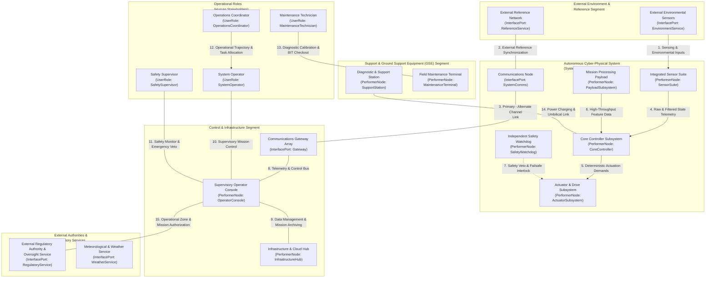
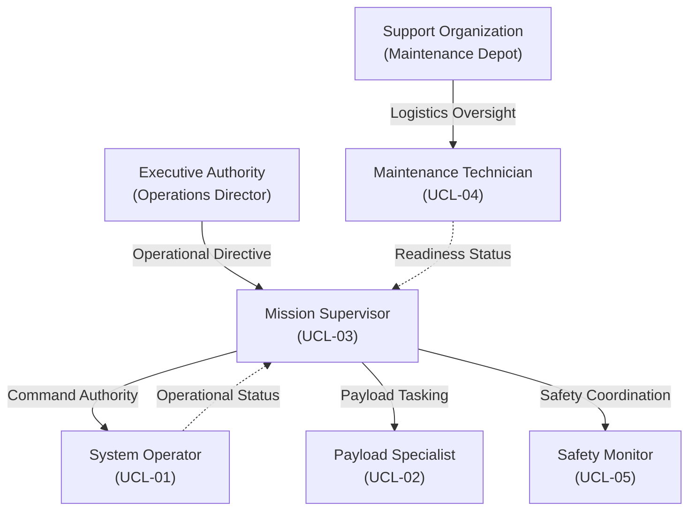

| Attribute | Value |
| :--- | :--- |
| **Title** | Scope, System Identification & Normative Baseline |
| **Version** | {{DOCUMENT_VERSION}} |
| **Date** | {{DOCUMENT_DATE}} |

# Concept of Operations (ConOps): {{SYSTEM_IDENTIFIER}}

## 1. Scope, System Identification & Normative Baseline

### 1.1 Document Metadata & Formal Governance
This Concept of Operations (ConOps) defines the operational architecture, coordinate reference systems, physical mass and resource limits, stakeholder interactions, operational environments, operational state space containment boundaries, and deterministic contingency protocols for {{SYSTEM_IDENTIFIER}}. This specification is authored in strict accordance with ISO/IEC/IEEE 29148:2018 §5.2.4 & §6.4.2, OMG Unified Architecture Framework (UAF) v2.0, INCOSE Systems Engineering Handbook v5.0, and {{PRIMARY_REGULATORY_STANDARD:ISO/IEC/IEEE 15288:2023}} (refs #117, #123, #128, #121).

| Attribute | Specification Value |
| :--- | :--- |
| **System Identifier** | {{SYSTEM_IDENTIFIER}} |
| **Document Version** | {{DOCUMENT_VERSION}} |
| **Publication Date** | {{DOCUMENT_DATE}} |
| **Security Classification** | {{SECURITY_CLASSIFICATION}} |
| **Target System Realization** | {{TARGET_SYSTEM_REALIZATION}} |
| **Authoring Organization** | {{AUTHORING_ORGANIZATION}} |
| **Issue Tracking Baseline** | refs #117, #123, #128, #121 |
| **Metamodel Baseline** | ISO/IEC/IEEE 29148:2018 / OMG UAF v2.0 / INCOSE SEH v5.0 |

### 1.2 System Classification & Operational Purpose
- **System Identifier:** `{{SYSTEM_IDENTIFIER}}`
- **Operational Domain:** `{{OPERATIONAL_DOMAIN}}`
- **Primary Operational Mission:** {{PRIMARY_OPERATIONAL_MISSION}}
- **Core Mission Capabilities:**
{{CORE_MISSION_CAPABILITIES}}

### 1.3 System Boundary & Operational State Space
The operational system boundary encompasses all physical, logical, communications, and organizational elements required to conduct end-to-end autonomous mission operations:
- **Operational State Space Envelope:** Operational State Space $\Omega_{\mathrm{state}} \subset \mathbb{R}^n$, bounded by physical, environmental, and operational parameter limits $\mathbf{X}_{\mathrm{boundary}} = [\mathbf{x}_{\mathrm{min}}, \mathbf{x}_{\mathrm{max}}]^\top$.
- **Lateral & Spatial Operating Boundary:** Designated operational perimeter bounded within a verified parametric containment buffer ($R_{\mathrm{buffer}}$) envelope.
- **Primary Communications Envelope:** Primary command and control (C2) operational range defined by $\text{Range}_{\mathrm{max}}(\text{Link}_{\mathrm{C2}})$ from the operator control node, backed by alternate network links and contingency communication channels.
- **Normative & Governance Boundary:** Governed under ISO/IEC/IEEE 29148:2018 requirements engineering processes, OMG UAF v2.0 operational architectures, and system safety assurance baselines.

- **Operational State Space Parameter Definitions & Engineering Units:**

| Symbol / Parameter | Domain / Context | Description | Dimension / Limits | Engineering Unit | Normative / Safety Basis |
| :--- | :--- | :--- | :--- | :--- | :--- |
| Ω_state | State Space Domain | Admissible operational state space envelope (Ω_state ⊂ R^n) | Compact subset of R^n (n >= 6) | Dimensionless | {{STATE_SPACE_STANDARD:ISO/IEC/IEEE 29148:2018 §6.4.2}} |
| X_boundary | State Vector Bounds | Bounding box of admissible operational states [x_min, x_max]^T | Bounded hyper-rectangle | Mixed SI Units | {{SAFETY_BOUNDS_STANDARD:ISO/IEC/IEEE 15288:2023 §6.4.2}} |
| x_min | State Lower Limit | Minimum permissible state vector threshold | {{STATE_VECTOR_MIN_EXPRESSION:[x_{1,\min}, x_{2,\min}, \dots, x_{n,\min}]^\top}} | {{STATE_VECTOR_MIN_UNITS:Mixed SI Units}} | {{STATE_SAFETY_MITIGATION:Functional Safety Mitigation M1}} |
| x_max | State Upper Limit | Maximum permissible state vector threshold | {{STATE_VECTOR_MAX_EXPRESSION:[x_{1,\max}, x_{2,\max}, \dots, x_{n,\max}]^\top}} | {{STATE_VECTOR_MAX_UNITS:Mixed SI Units}} | {{STATE_SAFETY_MITIGATION:Functional Safety Mitigation M1}} |
| d_containment | Spatial Containment | Verified 1:1 parametric operational containment boundary buffer distance | d_containment >= 1.0 * Distance_containment | {{CONTAINMENT_BUFFER_UNIT:m}} | {{CONTAINMENT_STANDARD:ISO/IEC/IEEE 15288:2023 §6.4.3}} |
| Gamma_C2 | Communications Channel | Abstract command and control channel capacity (throughput B, latency tau_latency, loss P_loss) | Range_max >= Range_nominal | km | {{C2_STANDARD:ISO/IEC/IEEE 29148:2018 §6.4.2}} |
| tau_containment | Emergency Response | Maximum allowable failsafe containment response time | tau_containment <= 2.0 | s | {{CONTAINMENT_RESPONSE_STANDARD:ISO/IEC/IEEE 15288:2023 §6.4.3}} |

### 1.3.1 Parametric Coordinate Reference Frames Math
The cyber-physical state estimation, guidance, and navigation architecture is mathematically formulated across three standardized, right-handed orthogonal coordinate reference frames:

1. **Primary Global Geodetic Frame ($\mathbf{p}_{\mathrm{geodetic}}$):**
   Earth-fixed curvilinear geodetic frame referenced to the WGS-84 reference ellipsoid, defined by geodetic latitude $\phi$, geodetic longitude $\lambda$, and ellipsoidal height $h_{\mathrm{ellips}}$:

$$
\begin{aligned}
\mathbf{p}_{\mathrm{geodetic}} &= \begin{bmatrix} \phi \\ \lambda \\ h_{\mathrm{ellips}} \end{bmatrix}
\end{aligned}
$$

2. **Local Tangent Plane / Navigation Frame ($\mathbf{p}_n$ - Local NED):**
   Local Cartesian coordinate frame fixed to an arbitrary local reference origin $(\phi_0, \lambda_0, h_0)$ on the reference geoid/ellipsoid, with orthogonal axes oriented along North ($X_n$), East ($Y_n$), and Down ($Z_n$):

$$
\begin{aligned}
\mathbf{p}_n &= \begin{bmatrix} X_n \\ Y_n \\ Z_n \end{bmatrix}_{\mathrm{NED}}
\end{aligned}
$$

3. **Body-Fixed Geometric Frame ($\mathbf{p}_b$ - Body Frame):**
   Right-handed orthogonal Cartesian frame rigidly attached to the structural frame of the vehicle (vehicle chassis / locomotive body / subsea hull / spacecraft structure) with origin at the Center of Mass ($CG$). The axes comprise longitudinal axis $X_b$ (forward along vehicle nominal centerline), lateral axis $Y_b$ (starboard/right), and normal axis $Z_b$ (downward through vehicle bottom/belly, $Z_b = X_b \times Y_b$).
   - Body translational velocity vector $\mathbf{v}_b$:

$$
\begin{aligned}
\mathbf{v}_b &= \begin{bmatrix} u \\ v \\ w \end{bmatrix}^T
\end{aligned}
$$

   - Body angular rate vector $\boldsymbol{\omega}_{b/n}$:

$$
\begin{aligned}
\boldsymbol{\omega}_{b/n} &= \begin{bmatrix} p \\ q \\ r \end{bmatrix}^T
\end{aligned}
$$

4. **Kinematic Transformations & Attitude Dynamics:**
   The orientation of the Body-Fixed Frame relative to the Local NED Frame is parameterized by the Euler attitude vector $\boldsymbol{\Theta} = [\phi_{\mathrm{euler}}, \theta_{\mathrm{euler}}, \psi_{\mathrm{euler}}]^T$ via Direction Cosine Matrix $\mathbf{C}_b^n \in \mathrm{SO}(3)$:

$$
\begin{aligned}
\mathbf{v}_n &= \mathbf{C}_b^n \mathbf{v}_b \\
\dot{\mathbf{p}}_n &= \mathbf{C}_b^n \mathbf{v}_b \\
\mathbf{C}_b^n &= \begin{bmatrix}
\cos\theta \cos\psi & \sin\phi \sin\theta \cos\psi - \cos\phi \sin\psi & \cos\phi \sin\theta \cos\psi + \sin\phi \sin\psi \\
\cos\theta \sin\psi & \sin\phi \sin\theta \sin\psi + \cos\phi \cos\psi & \cos\phi \sin\theta \sin\psi - \sin\phi \cos\psi \\
-\sin\theta & \sin\phi \cos\theta & \cos\phi \cos\theta
\end{bmatrix} \\
\dot{\boldsymbol{\Theta}} &= \begin{bmatrix}
1 & \sin\phi \tan\theta & \cos\phi \tan\theta \\
0 & \cos\phi & -\sin\phi \\
0 & \sin\phi \sec\theta & \cos\phi \sec\theta
\end{bmatrix} \boldsymbol{\omega}_{b/n}
\end{aligned}
$$

- Parameter Definitions & Engineering Units:

| Symbol / Variable | Coordinate Frame | Description | Engineering Unit |
| :--- | :--- | :--- | :--- |
| phi | Global Geodetic (WGS-84) | Geodetic Latitude | rad or deg |
| lambda | Global Geodetic (WGS-84) | Geodetic Longitude | rad or deg |
| h_ellips | Global Geodetic (WGS-84) | Ellipsoidal Height above Reference Ellipsoid | m |
| X_n, Y_n, Z_n | Local Tangent Plane (NED) | North, East, Down Position Coordinates | m |
| X_b, Y_b, Z_b | Body-Fixed Frame | Longitudinal (Surge), Lateral (Sway), Normal (Heave) Axes | m |
| v_b = [u, v, w]^T | Body-Fixed Frame | Body Translational Velocity (Surge u, Sway v, Heave w) | m/s |
| omega_b/n = [p, q, r]^T | Body-Fixed Frame | Body Angular Rates (Roll p, Pitch q, Yaw r) | rad/s or deg/s |
| C_b^n | Transformation SO(3) | Direction Cosine Matrix (Body to NED) | Dimensionless |
| Theta = [phi, theta, psi]^T | Attitude Representation | Euler Angles (Roll phi, Pitch theta, Yaw psi) | rad or deg |

### 1.3.2 Parametric Subsystem Mass/Resource Budget Breakdown Table
The system architecture decomposes into six canonical Abstract System Topology (AST) structural groups. Mass allocations and power resource budgets are partitioned parametrically to maintain strict mass fraction boundaries summing to 100.0% Maximum Operating Gross Mass (M_max):

| Structural Group (AST Partition) | Allocated Subsystems & Components | Mass Fraction (% M_max) | Mass Budget (kg) | Nominal Power Budget (W) | Peak Power Budget (W) |
| :--- | :--- | :--- | :--- | :--- | :--- |
| **{{STRUCTURE_PARTITION_LABEL:Primary Mechanical Structure / Chassis Partition}}** | Chassis primary structure, structural spars, mounting bulkheads, enclosure/gear | {{MASS_FRACTION_STRUCTURE_PCT:30.0}}% | {{MASS_BUDGET_STRUCTURE_KG:7.5}} | {{POWER_NOMINAL_STRUCTURE_W:0.0}} | {{POWER_PEAK_STRUCTURE_W:0.0}} |
| **Core Computing & Controller Subsystem** | Core Real-Time Controller Node, redundant IMU/GNSS, navigation processing unit, C2 transceiver, safety watchdog | {{MASS_FRACTION_CONTROLLER_PCT:15.0}}% | {{MASS_BUDGET_CONTROLLER_KG:3.75}} | {{POWER_NOMINAL_CONTROLLER_W:25.0}} | {{POWER_PEAK_CONTROLLER_W:50.0}} |
| **Propulsion & Power Distribution** | Actuators, electric motors, electronic speed controllers (ESCs), power distribution unit (PDU) | {{MASS_FRACTION_PROPULSION_PCT}}% | {{MASS_BUDGET_PROPULSION_KG}} | {{POWER_NOMINAL_PROPULSION_W}} | {{POWER_PEAK_PROPULSION_W}} |
| **Energy Storage Subsystem** | Smart battery module / fuel cell stack, Battery Management System (BMS), safety disconnect contactors | {{MASS_FRACTION_ENERGY_PCT}}% | {{MASS_BUDGET_ENERGY_KG}} | {{POWER_NOMINAL_ENERGY_W}} | {{POWER_PEAK_ENERGY_W}} |
| **Primary Mission Payload** | Multi-modal mission sensor suite, edge neural processing accelerator, payload gimbal, local storage | {{MASS_FRACTION_PAYLOAD_PCT}}% | {{MASS_BUDGET_PAYLOAD_KG}} | {{POWER_NOMINAL_PAYLOAD_W}} | {{POWER_PEAK_PAYLOAD_W}} |
| **Autonomous Failsafe Containment** | Independent safety watchdog, {{FAILSAFE_CONTAINMENT_NAME:Autonomous Containment Actuator / Failsafe Interlocks}}, emergency containment interlocks | {{MASS_FRACTION_CONTAINMENT_PCT}}% | {{MASS_BUDGET_CONTAINMENT_KG}} | {{POWER_NOMINAL_CONTAINMENT_W}} | {{POWER_PEAK_CONTAINMENT_W}} |
| **Total System Integration** | **Integrated Cyber-Physical Platform (6 AST Structural Groups)** | **100.0% M_max** | **{{TOTAL_MASS_KG}}** | **{{TOTAL_POWER_NOMINAL_W}}** | **{{TOTAL_POWER_PEAK_W}}** |

### 1.3.3 Master Physical Limits Table
The cyber-physical vehicle operates under bounding physical, aerodynamic/kinematic, and environmental limits:

| Parameter ID | Bounding Parameter Name | Parametric Symbol | Threshold (Boundary Limit) | Objective (Nominal Target) | Engineering Unit | Normative / Safety Basis |
| :--- | :--- | :--- | :--- | :--- | :--- | :--- |
| **PL-01** | Maximum Operating Gross Mass (M_max) | m_max | <= {{M_MAX_LIMIT_KG}} | {{M_MAX_NOMINAL_KG}} | kg | Certified maximum structural mass limit |
| **PL-02** | Maximum Payload Mass Capacity | m_payload_max | >= {{PAYLOAD_MAX_KG}} | {{PAYLOAD_NOMINAL_KG}} | kg | Usable mission payload mass reserve |
| **PL-03** | Physical Dimensions (Length x Width x Height) | L_x, L_y, L_z | <= {{DIM_MAX_L_M}} x {{DIM_MAX_W_M}} x {{DIM_MAX_H_M}} | {{DIM_NOM_L_M}} x {{DIM_NOM_W_M}} x {{DIM_NOM_H_M}} | m | Spatial transport and operational clearance envelope |
| **PL-04** | Nominal Cruise Velocity | V_cruise | {{V_CRUISE_MIN_MPS}} - {{V_CRUISE_MAX_MPS}} | {{V_CRUISE_NOMINAL_MPS}} | m/s | Optimum aerodynamic / dynamic transit speed |
| **PL-05** | Maximum Permissible Operating Velocity | V_max | <= {{V_MAX_MPS}} | {{V_MAX_NOMINAL_MPS}} | m/s | Never-exceed boundary limit (V_ne) |
| **PL-06** | Minimum Operational Velocity | V_min | <= {{V_MIN_MAX_MPS}} | {{V_MIN_NOMINAL_MPS}} | m/s | Minimum steady state controllable velocity limit |
| **PL-07** | Maximum Operating Spatial Boundary | d_max | <= {{SPATIAL_LIMIT_MAX_M}} | {{SPATIAL_LIMIT_NOMINAL_M}} | {{SPATIAL_LIMIT_UNIT:m}} | Maximum certified operational boundary limit |
| **PL-08** | Command & Control (C2) Datalink Range | Range_C2 | >= {{C2_RANGE_MIN_KM}} | {{C2_RANGE_NOMINAL_KM}} | km | Beyond-Line-of-Sight / Line-of-Sight C2 range margin |
| **PL-09** | Mission Operational Endurance | t_endurance | >= {{ENDURANCE_MIN_MIN}} | {{ENDURANCE_NOMINAL_MIN}} | min | Continuous nominal execution duration |
| **PL-10** | Environmental Operating Temperature Envelope | T_env | {{TEMP_MIN_DEGC}} to {{TEMP_MAX_DEGC}} | {{TEMP_NOMINAL_DEGC}} | °C | ISO 16750 / IEC 60068 climatic envelope |
| **PL-11** | Maximum Operating Wind / Gust Envelope | v_wind_max | <= {{WIND_LIMIT_MAX_MPS}} | {{WIND_LIMIT_NOMINAL_MPS}} | m/s | Dynamic boundary containment and stability limit |
| **PL-12** | Environmental Ingress Protection Envelope | IP_rating | >= {{INGRESS_PROTECTION_RATING}} | {{INGRESS_PROTECTION_TARGET}} | IP Code | Hermetic enclosure sealing per ISO 20653 / IEC 60529 |

### 1.4 Abstract UAF Context Diagram
The following Unified Architecture Framework (UAF) operational context diagram defines the external interfaces, performer nodes, and primary interaction channels across the Space, Cyber-Physical Vehicle, Control/Infrastructure, Support/GSE, Operational Roles, and External Authorities segments:

### 1.5 Normative Standards & Regulatory Baseline
The following normative standards and regulatory baselines govern all architectural, operational, safety, and verification artifacts within this Concept of Operations:

| Standard ID | Issuing Body | Title & Baseline Edition | Applicable Clauses & Focus Areas |
| :--- | :--- | :--- | :--- |
| ISO/IEC/IEEE 29148:2018 | ISO / IEC / IEEE | Systems and Software Engineering -- Life Cycle Processes -- Requirements Engineering | §5.2.4 ConOps Development Process, §6.4.2 Concept of Operations Baseline Specification, §6.4.3 Operational Concept Document Structure |
| ISO/IEC/IEEE 15288:2023 | ISO / IEC / IEEE | Systems and Software Engineering -- System Life Cycle Processes | §6.4 Technical Processes, §6.4.2 Stakeholder Needs and Requirements Definition, §6.4.3 Architecture Definition Process |
| INCOSE SEH v5.0 | INCOSE | Systems Engineering Handbook (5th Edition) | §3.3 Operational Concepts & §4.2 Requirements Engineering |
| OMG UAF v2.0 | OMG | Unified Architecture Framework Specification | Operational Domain Views (Op-Pr, Op-Tx, Op-Is) |
| IEC 61508 / ISO 26262 | IEC / ISO | Functional Safety of Electrical/Electronic/Programmable Electronic Safety-Related Systems | Functional safety lifecycle, safety integrity levels, hazard mitigation, and fail-safe interlocks |
| ISO 16750 / IEC 60068 | ISO / IEC | Environmental Conditions and Testing for Electrical and Electronic Equipment | Climatic, mechanical, chemical, and electrical environmental operating limits |
| CISPR 32 / IEC 61000-4 | CISPR / IEC | Electromagnetic Compatibility (EMC) Requirements and Testing | Conducted and radiated emissions and susceptibility testing standards |
| ISO/IEC 27001 / NIST SP 800-82r3 | ISO / IEC / NIST | Information Security Management & Guide to Operational Technology (OT) Security | Zero-Trust architecture, device hardening, telemetry authentication, and firmware integrity |
{{DOMAIN_REGULATORY_STANDARDS_TABLE_ROWS}}

### 1.6 User Classes and Other Involved Personnel
In accordance with ISO/IEC/IEEE 29148:2018 §5.2.4 and the operational baseline, the operational user classes and involved personnel are defined as follows:

| User Class ID | Title | Player or Operator | Interfacing Stakeholder | Characteristics & Responsibilities | Training & Qualification | Constraint Source |
| :--- | :--- | :--- | :--- | :--- | :--- | :--- |
| **UCL-01** | System Operator (SO) | Direct Operator | Operational Safety Authority / Operations Lead | Holds primary operational responsibility for system supervision, trajectory oversight, boundary deconfliction, and manual failsafe override initiation. | Certified System Operator with Type Qualification and Supervisory Control Certification | ISO/IEC/IEEE 29148:2018 §5.2.4 |
| **UCL-02** | Payload / Data Specialist (PS) | Direct Operator | Operations Center / Analytics Team | Responsible for multi-modal sensor tasking, tracking zone definition, real-time feature identification, and data stream management. | Certified Sensor Payload Specialist & Data Acquisition Qualification | ISO/IEC/IEEE 29148:2018 §5.2.4 |
| **UCL-03** | Mission Supervisor (MS) | Supervisor / Player | Executive Authority / Operations Director | Establishes operational rules, authorizes mission execution and abort commands, manages multi-system allocations, and coordinates external interfaces. | Senior Operations Supervisor Qualification & System Safety Management Certification | ISO/IEC/IEEE 15288:2023 §6.4.2 |
| **UCL-04** | Maintenance Technician (MT) | Support Operator | Maintenance Depot / Quality Assurance Office | Conducts Organizational (O-Level) pre-operation inspections, resource module replacements, structural integrity checks, sensor calibration, and modular LRU swaps. | Certified Maintenance Technician / Field Hardware Specialist | ISO/IEC/IEEE 29148:2018 §5.2.4 |
| **UCL-05** | Safety Monitor (SM) | Field Support | Local Environment Monitoring Staff | Maintains continuous monitoring of surrounding operational boundaries to detect environmental anomalies and non-cooperative entities within the operational state space. | Certified Safety Observer Training & Operational Communication Protocol Qualification | ISO/IEC/IEEE 15288:2023 §6.4.3 |

#### 1.6.1 DoDAF OV-4 / OMG UAF Op-Or Organizational Command & Authority Hierarchy
The following diagram defines the organizational command structure, supervisory authority hierarchy, and reporting relationships across the executive, supervisory, operational, and maintenance tiers in accordance with DoDAF 2.02 OV-4, OMG UAF v2.0 Op-Or, and ISO/IEC/IEEE 29148 §6.4.3:

