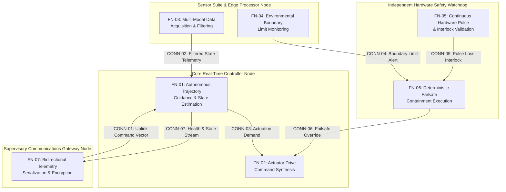

| Attribute | Value |
| :--- | :--- |
| **Title** | System Operational Architecture & Physical Subsystem Decomposition |
| **Version** | 1.0.0 |
| **Date** | 2026-09-02 |

## 4. System Operational Architecture & Physical Subsystem Decomposition

### 4.1 Super-System Operational Architecture & Segment Boundaries
In accordance with IEEE Std 1362-1998 §5.3, ISO/IEC/IEEE 29148:2018 §6.4.2-§6.4.3, DoDAF 2.02 SV-1, and ISO/IEC/IEEE 15288:2023 §6.4.4, the super-system operational architecture is partitioned across major physical segments and operational boundaries with discrete port definitions and traceable connection item flows, maintaining 1:1 parity with the canonical SSOT Architecture Views Library (`docs/architecture/views/sv1_super_system.mmd`).

{{SUPER_SYSTEM_ARCHITECTURE}}

### 4.2 Super-System Segment Allocation Matrix
Physical subsystems, computational nodes, and functional elements are allocated across operational segments to enforce clear physical and organizational ownership boundaries.

{{SEGMENT_ALLOCATION_MATRIX}}

### 4.3 Subsystem Architecture (100% AST Part Coverage)
In accordance with ISO/IEC/IEEE 29148:2018 §6.4.3, IEEE Std 1362-1998 §5.3, and the Pure Schema-Driven Compiler Invariant, physical and logical subsystems are derived deterministically from the abstract SysML v2 AST part definitions.

{{SUBSYSTEM_ARCHITECTURE_SECTION}}

### 4.4 Port Taxonomy & Interface Interconnects
Taxonomy of operational and physical interface ports connecting subsystems, communication buses, and external interaction points.

{{PORT_TAXONOMY_SECTION}}

### 4.5 Level 0 SSOT Model Binding Statement
Formal declaration binding this operational architecture specification to the authoritative Single Source of Truth (SSOT) Model-Based Systems Engineering (MBSE) AST schema.

{{MODEL_BINDING_STATEMENT}}

### 4.6 DoDAF SV-4 / UAF Rs-Fn Function-to-Subsystem Allocation Architecture
In accordance with DoDAF 2.02 SV-4, OMG UAF v2.0 Resource Functions (Rs-Fn), and ISO/IEC/IEEE 15288:2023 §6.4.4, system functional operations and actions are allocated deterministically to physical subsystem performer nodes. This allocation enforces strict operational decoupling, modular real-time determinism, and direct traceability to executable digital twin control synthesis models.

