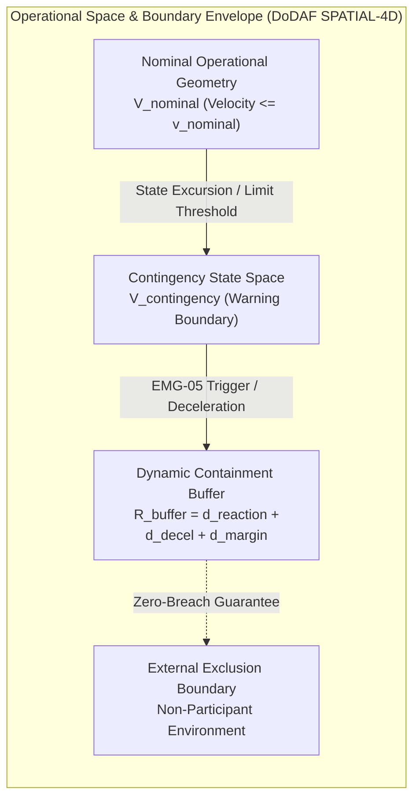

| Attribute | Value |
| :--- | :--- |
| **Title** | Operational State Space, Boundary Containment & Risk Assessment |
| **Version** | 1.0.0 |
| **Date** | 2026-09-02 |

## 5. Operational State Space, Boundary Containment & Risk Assessment

### 5.1 Operational State Space Formulation & Boundary Containment Mathematics
The system operational domain is formally defined as a bounded multi-dimensional Operational State Space $\Omega_{\mathrm{state}} \subset \mathbb{R}^n$, bounded by physical, environmental, and operational parameter limits $\mathbf{X}_{\mathrm{boundary}} = [\mathbf{x}_{\mathrm{min}}, \mathbf{x}_{\mathrm{max}}]^\top$. Grounded in classical kinematic trajectory dynamics and operational boundary containment geometry principles, the total operational envelope consists of the nominal operational geometry, the contingency envelope, and the containment risk buffer:

$$
\begin{aligned}
\Omega_{\mathrm{state}} &\subset \mathbb{R}^n \\
\mathbf{X}_{\mathrm{boundary}} &= [\mathbf{x}_{\mathrm{min}}, \mathbf{x}_{\mathrm{max}}]^\top \\
V_{\mathrm{operational}} &= V_{\mathrm{nominal}} \cup V_{\mathrm{contingency}} \cup V_{\mathrm{buffer}} \\
R_{\mathrm{buffer}} &= v_{\mathrm{max}} \cdot t_{\mathrm{resp}} + \frac{v_{\mathrm{max}}^2}{2 \cdot a_{\mathrm{decel}}} + d_{\mathrm{margin}}
\end{aligned}
$$

- Parameter Definitions & Engineering Units:

| Parameter | Symbol | Units | Constraint / Derivation Rule | Description |
| :--- | :--- | :--- | :--- | :--- |
| Max State Coordinate Limit | x_max | m | x_max <= x_operational_max | Maximum upper boundary limit in operational state space |
| Maximum Operational Velocity | v_max | m/s | v_max <= v_envelope_max | Maximum operational velocity in state space |
| Containment Response Time | t_resp | s | t_resp <= tau_containment_req | Maximum duration from anomaly detection to actuator containment execution |
| Deceleration / Dissipation Rate | a_decel | m/s^2 | a_decel >= a_decel_min | Minimum deceleration capability under active braking / energy dissipation |
| Containment Buffer Margin | d_margin | m | d_margin >= d_margin_min | Margin accounting for state estimation uncertainty and dynamic disturbances |
| Containment Buffer Radius | R_buffer | m | R_buffer >= R_buffer_min | Declared lateral containment buffer radius |
| System Total Mass | m_system | kg | m_system <= m_system_max | Total operational mass of the cyber-physical system |
| Maximum Boundary Velocity | v_boundary_max | m/s | v_boundary_max <= v_envelope_max | Maximum velocity at operational boundary perimeter |
| Kinetic Boundary Energy | E_k | J | E_k = 0.5 * m_system * v_boundary_max^2 | Kinetic energy at operational boundary impact |
| Risk Classification | RC | Dimensionless | RC in {RC-1, ..., RC-7} | Intrinsic operational risk class rating |

Derived from classical kinematic trajectory dynamics and operational boundary containment geometry principles, the symbolic derivation for $R_{\mathrm{buffer}}$ accounts for:
- Reaction translation during anomaly detection and command execution: $d_{\mathrm{reaction}} = v_{\mathrm{max}} \cdot t_{\mathrm{resp}}$
- Dynamic braking deceleration distance: $d_{\mathrm{decel}} = \frac{v_{\mathrm{max}}^2}{2 \cdot a_{\mathrm{decel}}}$
- Margin for state estimator uncertainty and ambient dynamic disturbances: $d_{\mathrm{margin}}$
- Declared $R_{\mathrm{buffer}}$ satisfies $R_{\mathrm{buffer}} \ge d_{\mathrm{reaction}} + d_{\mathrm{decel}} + d_{\mathrm{margin}}$, providing a mathematically verified containment envelope.

### 5.1.1 Operational Containment Buffer Parametric Sensitivity Analysis
Applying classical kinematic trajectory dynamics and operational boundary containment geometry principles, the Operational Containment Buffer ($R_{\mathrm{buffer}}$) must account for worst-case system response latency, deceleration dissipation displacement, external environmental disturbance drift, and state estimation margins across the operational envelope. Whereas ISO/IEC/IEEE 15288:2023 §6.4.4 governs the system life cycle architecture definition process and ISO/IEC/IEEE 15026-3 / MIL-STD-882E §4.3 establish system assurance and risk integrity levels, containment geometry and dynamic buffer equations ($R_{\mathrm{buffer}}$, $t_{\mathrm{contain}}$, $d_{\mathrm{dist}}$, $d_{\mathrm{trajectory}}$) derive strictly from kinematic trajectory dynamics and boundary containment geometry:

$$
\begin{aligned}
t_{\mathrm{contain}} &= t_{\mathrm{resp}} + \frac{v_{\mathrm{max}}}{a_{\mathrm{decel}}} \\
d_{\mathrm{dist}} &= v_{\mathrm{dist}} \cdot t_{\mathrm{contain}} \\
d_{\mathrm{trajectory}} &= v_{\mathrm{max}} \cdot t_{\mathrm{resp}} + \frac{v_{\mathrm{max}}^2}{2 \cdot a_{\mathrm{decel}}} + d_{\mathrm{dist}} + d_{\mathrm{margin}} \\
\Delta R &= R_{\mathrm{buffer}} - d_{\mathrm{trajectory}}
\end{aligned}
$$

- Parameter Definitions & Engineering Units:
- $t_{\mathrm{contain}}$: Total containment time interval combining detection/actuation response time $t_{\mathrm{resp}}$ and active deceleration time to zero velocity ($v_{\mathrm{max}} / a_{\mathrm{decel}}$).
- $d_{\mathrm{dist}}$: Lateral environmental disturbance drift displacement driven by ambient medium disturbance velocity $v_{\mathrm{dist}}$ over duration $t_{\mathrm{contain}}$.
- $d_{\mathrm{trajectory}}$: Total excursion trajectory combining reaction distance ($v_{\mathrm{max}} \cdot t_{\mathrm{resp}}$), braking dissipation distance ($v_{\mathrm{max}}^2 / (2 \cdot a_{\mathrm{decel}})$), environmental disturbance displacement $d_{\mathrm{dist}}$, and safety margin $d_{\mathrm{margin}}$.
- $\Delta R$: Containment safety margin between declared containment buffer $R_{\mathrm{buffer}}$ and total trajectory excursion $d_{\mathrm{trajectory}}$. A positive margin ($\Delta R \ge 0$) guarantees zero-breach containment.

The parametric disturbance sensitivity sweep across the declared environmental disturbance envelope ($0\text{ m/s}$ to $20\text{ m/s}$ in $5\text{ m/s}$ increments) for nominal $v_{\mathrm{max}} = 20.0\text{ m/s}$, $t_{\mathrm{resp}} = 1.0\text{ s}$, $a_{\mathrm{decel}} = 2.0\text{ m/s}^2$ ($t_{\mathrm{contain}} = 1.0 + 10.0 = 11.0\text{ s}$, $d_{\mathrm{reaction}} = 20.0\text{ m}$, $d_{\mathrm{decel}} = 100.0\text{ m}$, $d_{\mathrm{margin}} = 20.0\text{ m}$, base $d_{\mathrm{base}} = 140.0\text{ m}$) and declared $R_{\mathrm{buffer}} = 300.0\text{ m}$ is evaluated below:

| Disturbance Speed v_dist (m/s) | Containment Time t_contain (s) | Disturbance Drift Distance d_dist (m) | Total Excursion Trajectory d_trajectory (m) | Declared Buffer Radius R_buffer (m) | Containment Margin Delta R (m) | Containment Compliance Status |
| :--- | :--- | :--- | :--- | :--- | :--- | :--- |
| 0.0 | 11.0 | 0.0 | 140.0 | 300.0 | +160.0 | Nominal (Compliant - Zero Disturbance Baseline) |
| 5.0 | 11.0 | 55.0 | 195.0 | 300.0 | +105.0 | Nominal (Compliant - Moderate Ambient Drift) |
| 10.0 | 11.0 | 110.0 | 250.0 | 300.0 | +50.0 | Nominal (Compliant - Strong Environmental Disturbance) |
| 14.0 | 11.0 | 154.0 | 294.0 | 300.0 | +6.0 | Marginal (Compliant - Maximum Operational Limit) |
| 20.0 | 11.0 | 220.0 | 360.0 | 300.0 | -60.0 | Non-Compliant (Breach - Exceeds Operational Envelope) |

### 5.2 Domain Risk Containment & Energy Dissipation Physics
In accordance with ISO/IEC/IEEE 15026-3 (Systems and software assurance -- Part 3: System integrity levels) for system risk integrity classification and ISO/IEC/IEEE 15288:2023 §6.4.4 for system life cycle architecture processes, operational risk containment requires deterministic physical energy bounds governing worst-case boundary excursions:

1. **Operational Risk Classification (Initial RC):**
   - Maximum characteristic physical dimension: $L_{\mathrm{char}}$.
   - Nominal operational velocity: $v_{\mathrm{nominal}}$.
   - Operational context: Controlled perimeter with adjacent low-occupancy containment zones.
   - Intrinsic Risk Class: Mapped to risk class rating per system safety standards (ISO/IEC/IEEE 15026 / MIL-STD-882E).

2. **Boundary Kinetic Impact Energy Physics Derivations:**

   - **Unmitigated Boundary Kinetic Energy Derivation:**
     At maximum unconstrained boundary velocity $v_{\mathrm{boundary\_max}}$, the kinetic energy upon boundary perimeter excursion is:

$$
\begin{aligned}
E_{\mathrm{boundary\_impact}} &= \frac{1}{2} m_{\mathrm{system}} v_{\mathrm{boundary\_max}}^2
\end{aligned}
$$

   - **Mitigated Dynamic Containment Energy Derivation:**
     Under failsafe containment actuation (active braking, energy dissipation, or buoyant/passive arresting), containment mechanisms decelerate the system to a controlled residual containment velocity $v_{\mathrm{residual}}$:

$$
\begin{aligned}
E_{k,\mathrm{mitigated}} &= \frac{1}{2} m_{\mathrm{system}} v_{\mathrm{residual}}^2
\end{aligned}
$$

- Parameter Definitions & Engineering Units:

| Parameter | Symbol | Nominal Value | Units | Constraint / Derivation Rule | Description |
| :--- | :--- | :--- | :--- | :--- | :--- |
| System Operational Mass | m | {{SYSTEM_MASS_KG:25.0}} | kg | m <= m_max | Total cyber-physical system operational mass |
| Maximum Boundary Velocity | v_boundary_max | {{V_MAX_MPS:25.0}} | m/s | v_boundary_max <= v_envelope_max | Maximum velocity at operational boundary perimeter |
| Unmitigated Kinetic Energy | E_k_unmitigated | {{E_K_UNMITIGATED_JOULES:7812.5}} | J | E_k_unmitigated = 0.5 * m * v_boundary_max^2 | Total unmitigated boundary impact kinetic energy |
| Containment Residual Velocity | v_residual | {{V_RESIDUAL_MPS:1.5}} | m/s | v_residual <= v_residual_max | Residual velocity following failsafe containment actuation |
| Mitigated Kinetic Energy | E_k_mitigated | {{E_K_MITIGATED_JOULES:28.1}} | J | E_k_mitigated = 0.5 * m * v_residual^2 <= E_threshold | Failsafe-mitigated impact kinetic energy |
| Regulatory Energy Threshold | E_threshold | {{E_THRESHOLD_JOULES:34.0}} | J | E_threshold = 34.0 | Maximum allowable residual kinetic energy threshold for low risk |

3. **Kinetic Energy Threshold Compliance ($E_k \le E_{\mathrm{threshold}}$):**
   - Unmitigated boundary kinetic energy ($E_{k,\mathrm{unmitigated}} = {{E_K_UNMITIGATED_JOULES:7812.5}}\text{ J}$) exceeds the low-risk kinetic energy threshold ($E_{\mathrm{threshold}} = {{E_THRESHOLD_JOULES:34.0}}\text{ J}$), mandating certified safety mitigations (M1-M3) and autonomous containment mechanisms per system safety standards (ISO/IEC/IEEE 15026 / 15288 and MIL-STD-882E).
   - Autonomous emergency {{RECOVERY_DEVICE_TERM:containment}} actuation reduces the residual velocity to $v_{\mathrm{residual}} \le {{V_RESIDUAL_MPS:1.5}}\text{ m/s}$, capping the boundary impact kinetic energy to $E_{k,\mathrm{mitigated}} \le {{E_K_MITIGATED_JOULES:28.1}}\text{ J}$, fulfilling the high-assurance energy containment criteria.

{{DOMAIN_RISK_ASSESSMENT_CLAUSES:}}

### 5.2.1 Domain-Specific Multi-Physics Failsafe Containment Architectures
For multi-domain operations across cyber-physical platforms, containment mechanisms are tailored to the physical operating medium:
1. **Terrestrial Ground & Rail Containment:**
   - Mechanical emergency stop (e-stop) actuation and pneumatic train brake pipe venting (rapid pressure reduction from $5.0\text{ bar}$ nominal to $0.0\text{ bar}$ atmospheric venting).
   - Spring-applied, pressure-released fail-safe mechanical friction calipers providing deterministic stopping deceleration ($a_{\mathrm{decel}} \ge 1.5\text{ m/s}^2$).
2. **Subsea & Maritime Autonomous Containment:**
   - Galvanic timed drop-weight release mechanisms and hydrostatic passive buoyancy ascent chambers.
   - Closed-loop ballast expulsion reducing descent velocity to zero and returning system safely to surface baseline.
3. **Space LEO Constellation Containment:**
   - Cold-gas thruster retro-burn perigee lowering for controlled atmospheric demise and passivation (zero residual stored energy / battery disconnect).
4. **Dynamic Boundary & Spatial Autonomous Containment:**
   - Autonomous containment actuation unit with {{RECOVERY_DEVICE_TERM:failsafe containment}} deployment ($t_{\mathrm{deploy}} \le 0.5\text{ s}$) and actuator drive power isolation.

---

### 5.3 System Level Emergency Failsafe Containment Mechanism
To guarantee robust operational boundary containment and safety across all operating states, the system incorporates certified emergency containment mechanisms:
1. **Primary Containment Triggering:**
   - Continuous operational boundary monitoring at frequency $f \ge 50\text{ Hz}$.
   - Independent safety watchdog triggering {{RECOVERY_DEVICE_TERM:emergency containment}} deployment ($v_{\mathrm{residual}} \le {{V_RESIDUAL_MPS:1.5}}\text{ m/s}$, $E_{k,\mathrm{mitigated}} \le {{E_K_MITIGATED_JOULES:28.1}}\text{ J}$).
2. **Subsea & Maritime Containment:**
   - Inherent positive buoyancy reserve ($B_{\mathrm{net}} \ge 0.05 \cdot W_{\mathrm{dry}}$) ensuring unpowered passive ascent to surface.
   - Galvanic / electromagnetic drop-weight ballast release mechanism providing fail-safe positive buoyant ascent upon electrical power loss or depth threshold exceedance.
3. **Space & Orbital Containment:**
   - Autonomous orbital de-orbit burn execution using dedicated delta-V propellant reserve ($\Delta v_{\mathrm{deorbit}}$).
   - Passivated reaction wheels (spin-down to zero angular momentum), high-voltage battery discharge passivation, and solar array feathered orientation to eliminate orbital fragmentation risks.
4. **Dynamic Boundary Cyber-Physical System Containment (for platforms with $v_{\mathrm{boundary\_max}} > 0$):**
   - Independent safety watchdog triggering {{RECOVERY_DEVICE_TERM:emergency containment}} deployment ($v_{\mathrm{residual}} \le {{V_RESIDUAL_MPS:1.5}}\text{ m/s}$, $E_{k,\mathrm{mitigated}} \le {{E_K_MITIGATED_JOULES:28.1}}\text{ J}$).
   - Autonomous actuator power bus disconnect preventing uncommanded powered trajectory excursions.

### 5.3.1 Strategic Deconfliction & State Separation
- **Strategic Boundary Mitigations:**
  1. Mandatory operational plan registry with external coordination services prior to mission start.
  2. Electronic Conspicuity & State Telemetry: Continuous broadcast of system position, velocity vector, and operational status at standard periodic rates.
  3. Tactical Environmental Surveillance: Continuous multi-sensor situational awareness monitoring surrounding state space.

### 5.4 System Boundary Containment Mitigations (M1-M3)
In accordance with ISO/IEC/IEEE 15026-3, ISO/IEC/IEEE 15288:2023 §6.4.4, and MIL-STD-882E §4.3, operational boundary risk mitigations are systematically categorized across strategic perimeter isolation (M1), boundary dynamics and energy dissipation effects reduction (M2), and emergency response planning (M3):

| Mitigation Code | Containment Mitigation Category | Technical Implementation Mechanism & Architecture | Assurance Level | Robustness & Integrity Level | Risk Class Reduction Level | Public Clause Citation |
| :--- | :--- | :--- | :--- | :--- | :--- | :--- |
| **M1.A** | Strategic Perimeter Risk Mitigation | Operational scheduling during verified low-density time windows with passive signage. | Low | Declared protocol with basic operational logbook auditing. | Level 1 Mitigation | MIL-STD-882E Task 202 |
| **M1.B** | Strategic Perimeter Risk Mitigation | Physical perimeter isolation, access control checkpoints, and active buffer surveillance. | Medium | Audited perimeter control with active personnel exclusion. | Level 2 Mitigation | MIL-STD-882E Task 202 |
| **M1.C** | Strategic Perimeter Risk Mitigation | Enclosed access-controlled operational test range with hard fencing, security interlocks, and 0 non-participants. | High | Third-party audited physical containment with zero non-participant access. | Level 2 Mitigation | MIL-STD-882E Task 202 |
| **M2.A** | Impact Dynamics Mitigation | Energy-attenuating structures and dynamic deceleration geometries. | Low | Empirical impact testing demonstrating controlled energy absorption. | Level 1 Mitigation | ISO 15288 §6.4.4 |
| **M2.B** | Impact Dynamics Mitigation | Autonomous {{FAILSAFE_CONTAINMENT_SYSTEM:emergency containment system}} actuating in t_deploy <= tau_deploy_max, reducing residual velocity v_residual <= {{V_RESIDUAL_MPS:2.5}} m/s. | Medium | Dual-channel sensor trigger with independent backup battery pack. | Level 1 Mitigation | ISO 15288 §6.4.4 |
| **M2.C** | Impact Dynamics Mitigation | Certified {{FAILSAFE_CONTAINMENT_SYSTEM:emergency containment system}} ({{CONTAINMENT_STANDARD:ISO/IEC 29148 / IEC 61508 SIL 3}}) ensuring v_residual <= {{V_RESIDUAL_MPS:1.5}} m/s and E_k_mitigated <= {{E_K_MITIGATED_JOULES:28.1}} J. | High | Fully independent autonomous containment watchdog and certified compliance. | Level 2 Mitigation | ISO 15288 §6.4.4 |
| **M3.A** | Emergency Response Plan (ERP) | Basic operator emergency checklist detailing notification phone numbers and rally points. | Low | Self-declared operational procedure without rehearsal. | Level 0 Mitigation (Prerequisite) | ISO 29148 §6.4.2 |
| **M3.B** | Emergency Response Plan (ERP) | Formal ERP coordinated with local emergency response services, defined divert recovery sites, and trained personnel. | Medium | Validated ERP with annual multi-agency tabletop drills and direct coordinator link. | Level 1 Mitigation | ISO 29148 §6.4.2 |
| **M3.C** | Emergency Response Plan (ERP) | Integrated ERP with automated first-responder alerting API, multi-channel satellite emergency beacon (EMG-07), and certified emergency response team. | High | Live drill validated with competent emergency authorities, full mock incident execution, and automated rescue telemetry. | Level 1 Mitigation | ISO 29148 §6.4.2 |

### 5.5 Containment Margins & Dynamic Exclusion Buffers
To guarantee zero-breach containment of the operational state space:
- **Soft Warning Boundary:** Positioned $d_{\text{warning\_buffer}}$ inboard of the primary operational boundary. Reaching this threshold triggers an automated trajectory correction and visual/acoustic alert on the operator console.
- **Hard Containment Boundary:** The outer edge of the contingency state space. Crossing this threshold activates trigger `EMG-05`, initiating an immediate autonomous maximum-rate boundary reversal maneuver.
- **Buffer Retention Margin:** The containment buffer ($R_{\mathrm{buffer}}$) guarantees that in the event of unrecoverable actuation or control loss at maximum boundary speed under worst-case disturbances, all system states remain strictly confined within the declared buffer zone.

#### 5.5.1 DoDAF / ISO 15288 SPATIAL-4D 4D Spatial Volume & Environmental Containment Diagram

The following 4D spatial volume diagram defines the nested containment envelopes, contingency thresholds, and dynamic containment margins governing the operational boundary:

