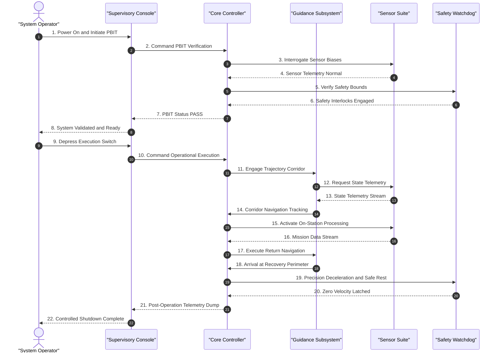
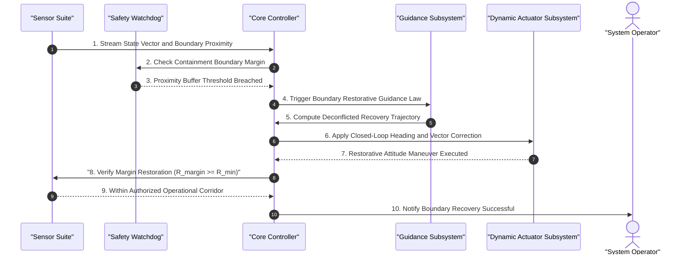
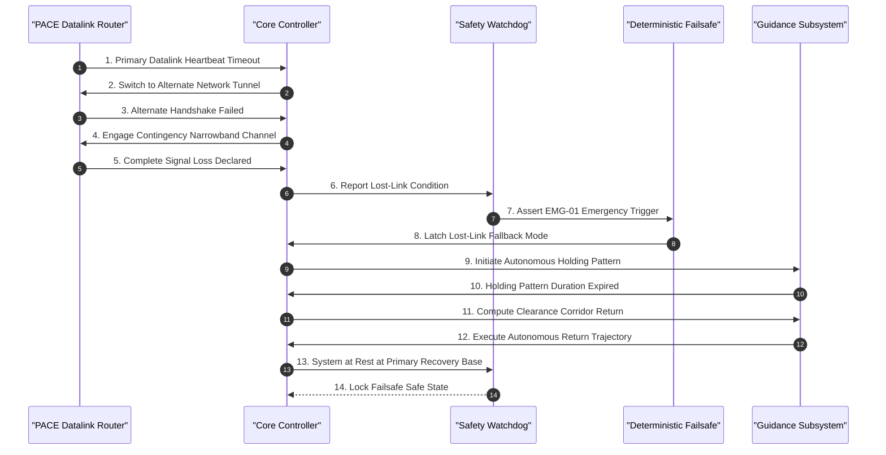
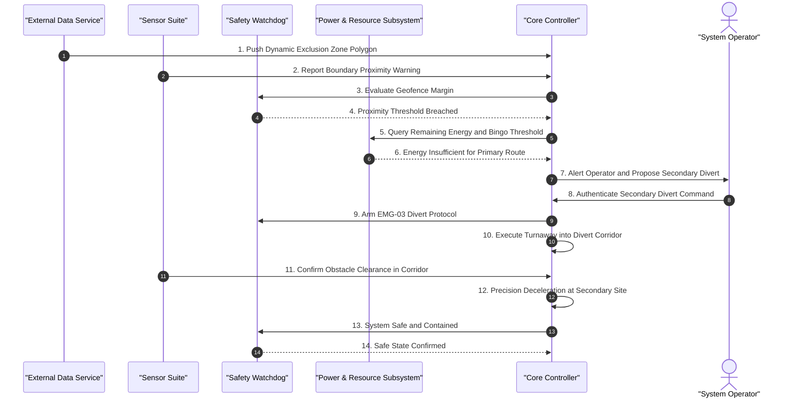
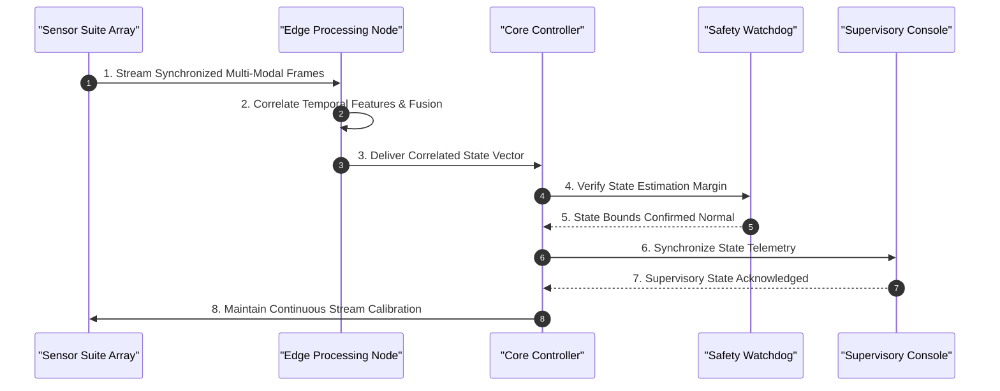
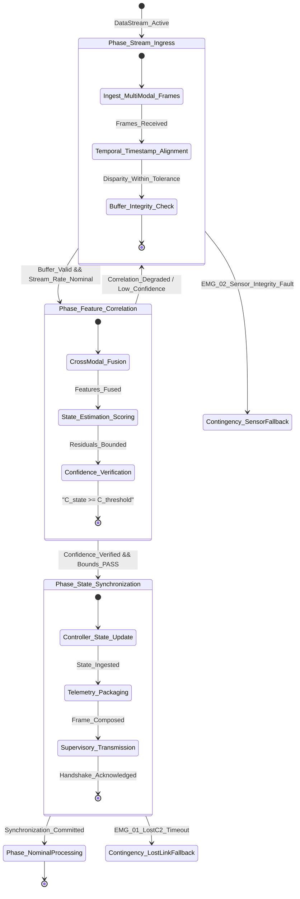

| Attribute | Value |
| :--- | :--- |
| **Title** | Multi-Threaded Operational Scenarios & System Timelines |
| **Version** | 1.0.0 |
| **Date** | 2026-09-02 |

## 9. Multi-Threaded Operational Scenarios & System Timelines

In accordance with ISO/IEC/IEEE 29148:2018 §6.4.2, OMG Unified Architecture Framework (UAF) v2.0 Operational Processes (Op-Pr), and MIL-STD-882E §4.3, this section specifies the multi-threaded operational scenarios, dynamic timelines, and deterministic decision gates governing the system lifecycle. All scenarios maintain 100% traceability to allocated operational activities (`OA-01`..`OA-08`), operational information exchanges (`OpTx-01`..`OpTx-08`), emergency containment triggers (`EMG-01`..`EMG-07`), and {{INTERLOCK_POLICY_NAME:Operational Safety Interlocks}} (`{{INTERLOCK_01_TAG:SAF-01}}`..`{{INTERLOCK_06_TAG:SAF-06}}`).

### 9.1 Scenario SCN-01: Normal Operational Cycle
Scenario `SCN-01` describes an end-to-end nominal operational lifecycle from pre-operation staging through autonomous state trajectory execution, on-station operational processing, precision recovery, and controlled shutdown.

| Step Number | Elapsed Time (T+) | Stimulus / Trigger | Actor / Performer | Action Executed | Telemetry Stream | Decision Gate | Exception Branch | Exit Criterion |
| :--- | :--- | :--- | :--- | :--- | :--- | :--- | :--- | :--- |
| **1** | T0 + Delta_t0 | Operator energizes Operator Station and connects primary energy module | Maintenance Technician / Core Controller / Safety Watchdog | Executes automated Pre-Operation Built-In-Test (PBIT) suite per OA-01; verifies sensor biases, actuator end-stops, cryptographic root of trust, and battery state-of-charge (SoC) | OpTx-01, OpTx-06 (PBIT Status: 100% PASS; Sensor biases <= epsilon_bias_max; SoC >= SoC_launch_min; Bus Voltage nominal; Link SNR >= SNR_min) | Gate GNG-01: PBIT 100% PASS & Pre-Operation Interlocks Verified | If PBIT fails or SoC < SoC_launch_min, abort startup; latch diagnostic fault code and transition to Phase_MaintenanceMode | PBIT verification flag logged; Pre-Operation interlocks green; Root-of-trust validated |
| **2** | T0 + Delta_t1 | Operations Coordinator issues authenticated Operation Authorization Token and mission profile | System Operator / Supervisory Operator Console | Ingests cryptographic mission plan, validates digital signatures, uploads waypoints and dynamic containment polygon to Core Controller via OpTx-07, enables system | OpTx-06, OpTx-07 (Controller Mode: Ready_Standby; Waypoints Loaded: N_wp; Containment Polygon Active: R_buffer declared; Checksum: MATCH) | Gate GNG-02: Mission Plan Checksum Match & Environmental Bounds Green | If signature invalid or perimeter outside allowable envelope, reject mission plan; remain in Phase_Startup | Cryptographic mission token verified; System configured in Ready_Standby; Supervisor gives execution clearance |
| **3** | T0 + Delta_t2 | System Operator depresses Dual-Action Execution Switch on Operator Console | Core Controller / Dynamic Actuator Subsystem | Initiates autonomous execution sequence per OA-02; commands actuators to transition profile, accelerates to nominal velocity v_nominal along ingress corridor | OpTx-01, OpTx-02, OpTx-06 (Speed: v_nominal; Trajectory Error e_track <= epsilon_track_max; Attitude rates nominal; Power draw nominal) | Gate GNG-03: Launch Corridor Clearance & Dynamic Stability Verified | If trajectory deviation e_track > epsilon_track_max or actuator fault detected, abort launch; transition to Contingency_BoundaryContainment / EMG-05 | Nominal operating speed v_nominal achieved; Ingress transition complete; Stable closed-loop tracking established |
| **4** | T0 + Delta_t3 | System reaches waypoint corridor boundary WP_ingress | Core Controller / Guidance Subsystem | Traverses multi-dimensional corridor towards operational station; continuously evaluates 4D state space boundaries and environmental limits per OA-05 | OpTx-01, OpTx-02, OpTx-06 (Cross-Track Error: e_xtrack <= epsilon_xtrack_max; Altitude/Position nominal; Wind/Disturbance <= Disturbance_limit) | Gate GNG-04: Corridor Containment & C2 Health Bounds Verified | If GNSS degraded or C2 SNR < SNR_min, execute PACE link failover per EMG-01 / EMG-02; divert to Contingency_DeadReckoning if unrecovered | Waypoint corridor traversed; System arrives at designated operational station perimeter |
| **5** | T0 + Delta_t4 | System crosses station boundary perimeter WP_station | Core Controller / Sensor Suite / Edge Processing Node | Transitions to operational station pattern; activates multi-modal payload data acquisition and edge neural inference per OA-03 and OA-04 | OpTx-04, OpTx-05, OpTx-06 (Payload Mode: ACTIVE_PROCESSING; Telemetry Stream: 100% nominal; Feature vectors emitted; Downlink rate nominal) | Gate GNG-05: Payload Health & Energy Reserve R(t) > R_bingo(t) Green | If payload sensor fault occurs or R(t) <= R_bingo(t), terminate on-station operations; initiate immediate egress per OA-06 / EMG-03 | Operational mission objectives satisfied; Sensor data streams verified; Continuous station keeping maintained |
| **6** | T0 + Delta_t5 | Primary operational objectives completed or Bingo energy threshold R_bingo reached | Core Controller / Guidance Core / Power & Resource Subsystem | Calculates optimal return trajectory corridor; stows payload into secure transit configuration; initiates nominal egress transit per OA-02 and OA-06 | OpTx-01, OpTx-02, OpTx-06 (Mode: Nominal_Egress_Transit; Distance to Base: d_base; Remaining Resource: R_current >= R_bingo; Payload: STOWED) | Gate GNG-06: Return Trajectory Clearance & Residual Energy Margin Verified | If headwind disturbance causes R_current < R_return + R_reserve, trigger secondary divert protocol to alternate landing site LZ-DIVERT-ALPHA per EMG-03 | Egress corridor entered; Standoff transit underway; Return trajectory checklist green |
| **7** | T0 + Delta_t6 | System arrives at primary recovery location boundary WP_recovery | Guidance Subsystem / Dynamic Actuator Subsystem / Recovery Beacon | Acquires precision recovery reference beacon, aligns vehicle axes, executes controlled deceleration profile to zero velocity, reaches safe rest at recovery node | OpTx-01, OpTx-02, OpTx-06 (Velocity: v_rest; Terminal alignment error: delta_pos <= epsilon_land; Actuator Power: ISOLATED; Structural loads nominal) | Gate GNG-07: Safe Recovery Alignment & Ground Sensor Confirmation | If recovery beacon lost or terminal misalignment exceeds epsilon_land_max, initiate automated go-around maneuver if energy permits, else execute precautionary stop per EMG-06 | Vehicle at rest (v_rest = 0.0); Actuators de-energized; Recovery interlocks committed |
| **8** | T0 + Delta_t7 | System at rest confirmation signal from ground sensors and internal IMU | Core Controller / Security Partition / Maintenance Technician | Executes post-operation secure shutdown per OA-08; offloads encrypted blackbox logs and high-bandwidth telemetry dump; sanitizes session security keys; enters safe power-down state | OpTx-06 (Mode: Phase_SecureShutdown; Telemetry Dump: 100% Complete; Security State: SECURED; Hardware Safe Lock: ENGAGED) | Gate GNG-08: Telemetry Integrity Checksum & Security Sanitization Verified | If diagnostic log transfer interrupted or memory fault detected, latch fault flag on non-volatile indicator; require manual diagnostic tether | Blackbox logs secured; System fully de-energized; System ready for post-operation turnaround or maintenance |

---

### 9.2 Scenario SCN-02: Boundary Excursion & Auto-Recovery
Scenario `SCN-02` details the closed-loop autonomous detection, containment evaluation, and restorative guidance trajectory execution when environmental disturbance or state drift approaches an authorized operational boundary.

| Step Number | Elapsed Time (T+) | Stimulus / Trigger | Actor / Performer | Action Executed | Telemetry Stream | Decision Gate | Exception Branch | Exit Criterion |
| :--- | :--- | :--- | :--- | :--- | :--- | :--- | :--- | :--- |
| **1** | T0 + Delta_t1 | Environmental disturbance or trajectory drift approaches operational corridor limit | Sensor Suite / Core Controller | Continuously samples navigation state vectors; evaluates distance to authorized containment perimeter d_margin per OA-05 | OpTx-01, OpTx-06 (Margin Distance: d_margin <= d_warning_threshold; Drift Velocity: v_drift; Containment Status: PROXIMITY_ALERT) | Gate GNG-B1: Containment Proximity Alert Threshold Breached | If proximity warning clears within filter window, log transient disturbance and maintain nominal tracking | Boundary proximity alert raised; Safety Watchdog armed for containment assessment |
| **2** | T0 + Delta_t2 | Proximity alert flag asserted on internal telemetry bus | Safety Watchdog / Core Controller | Evaluates safety containment boundary margin against minimum buffer constraint R_containment >= R_min per EMG-05 | OpTx-06 (Watchdog State: EVALUATING_CONTAINMENT; Buffer Error: Delta_R; Required Clearance: R_min) | Gate GNG-B2: Margin Constraint R_containment >= R_min Violation Detected | If margin remains valid, notify supervisory console without interrupting nominal guidance | Boundary excursion condition declared; Auto-recovery sub-mode latched |
| **3** | T0 + Delta_t3 | Safety Watchdog signals boundary excursion condition | Guidance Subsystem / Core Controller | Computes optimal restorative trajectory vector to re-align velocity with nominal corridor centerline per OA-02 | OpTx-01, OpTx-02 (Guidance Mode: AutoRecovery_Restorative; Correction Vector: [Delta_x, Delta_y, Delta_z]; Required Yaw/Bank Rate: omega_cmd) | Gate GNG-B3: Recovery Trajectory Kinematic Feasibility Verified | If kinematic limits exceeded or obstacle detected in recovery path, initiate contingency holding stop per EMG-05 | Restorative trajectory command generated and validated against dynamic limits |
| **4** | T0 + Delta_t4 | Restorative guidance demand dispatched to actuator bus | Dynamic Actuator Subsystem / Core Controller | Applies corrective control surface deflection or thrust vectoring; executes bank-to-turn restorative maneuver | OpTx-02, OpTx-03 (Actuator Demand: delta_act; Rate of Turn: omega_actual; Structural Load: n_z <= n_z_max) | Gate GNG-B4: Actuator Rate Saturation & Dynamic Load Within Limits | If actuator response stalls or control authority saturated, trigger secondary emergency containment trigger EMG-06 | Closed-loop restorative maneuver executed; Heading converging to corridor centerline |
| **5** | T0 + Delta_t5 | Trajectory converges to nominal corridor centerline | Guidance Subsystem / Sensor Suite / Safety Watchdog | Verifies that lateral deviation e_xtrack <= epsilon_xtrack_max and margin distance d_margin >= R_min are restored per OA-05 | OpTx-01, OpTx-06 (Cross-Track Error: e_xtrack <= epsilon_xtrack_max; Margin Restored: True; Containment Status: NOMINAL) | Gate GNG-B5: Boundary Containment Margin R_margin >= R_min Confirmed | If lateral divergence continues for tau_excursion_timeout, trigger emergency containment safes per EMG-05 | Operational corridor re-acquired; State trajectory restabilized |
| **6** | T0 + Delta_t6 | Corridor restabilization confirmed by Safety Watchdog | Core Controller / Supervisory Operator Console | Emits boundary recovery telemetry packet via OpTx-08; resumes nominal trajectory tracking; clears proximity warning flag | OpTx-06, OpTx-08 (Recovery Status: COMPLETED; Mode: Nominal_Corridor_Navigation; Event Code: BND_RECOVERY_SUCCESS) | Gate GNG-B6: Supervisory Acknowledgment & Telemetry Health Verified | If telemetry downlink degraded, queue recovery log in non-volatile buffer for post-operation offload | System operating nominally within corridor; Excursion event logged to blackbox audit store |

---

### 9.3 Scenario SCN-03: Degraded C2 Lost-Link & Autonomous Fallback Return
Scenario `SCN-03` defines the autonomous handling of primary communications failure, execution of PACE failover hierarchy, and fallback to deterministic lost-link return protocols.

| Step Number | Elapsed Time (T+) | Stimulus / Trigger | Actor / Performer | Action Executed | Telemetry Stream | Decision Gate | Exception Branch | Exit Criterion |
| :--- | :--- | :--- | :--- | :--- | :--- | :--- | :--- | :--- |
| **1** | T0 + Delta_t1 | Localized RF interference, jamming, or shadowing degrades Primary Point-to-Point datalink | PACE Communications Modem / Core Controller | Detects Primary link SNR dropping below SNR_threshold; detects consecutive lost heartbeat frames; starts Primary lost-link timer t_loss_primary | OpTx-06 (Primary Link Status: DEGRADED / TIMEOUT; Heartbeat Loss: t_loss >= tau_heartbeat_timeout_Primary; Active PACE Tier: Primary) | Gate GNG-C1: Primary Link Timeout Invariant tau_heartbeat_timeout_Primary Exceeded | If link SNR recovers before timeout expiration, reset lost-link timer; maintain Primary link | Primary datalink timeout declared; PACE automated failover sequence initiated |
| **2** | T0 + Delta_t2 | Primary link timeout threshold tau_heartbeat_timeout_Primary breached | PACE Datalink Router / Operator Console | Reroutes bidirectional C2 telemetry and control packets to Alternate encrypted network tunnel per CAP-03.2; initiates handshake verification | OpTx-06, OpTx-07 (Active Medium: Alternate_Network; Handshake Status: ESTABLISHED; Link Latency <= tau_C2_max; Downlink Bitrate nominal) | Gate GNG-C2: Alternate Network Cryptographic Handshake Verified | If Alternate handshake fails within tau_handshake_max, immediately fall through to Contingency narrowband channel | Alternate network tunnel active; Bidirectional supervisory control restored; Event logged |
| **3** | T0 + Delta_t3 | Environmental/infrastructure outage causes Alternate Network link failure | PACE Datalink Router / Core Controller | Detects loss of Alternate channel; falls back to Contingency robust narrowband RF command channel per CAP-03.3; throttles high-bandwidth payload data to preserve essential C2 bandwidth | OpTx-06 (Active Medium: Contingency_RF; Essential C2 Link: ACTIVE; Payload Stream: THROTTLED; Downlink: Essential State Telemetry Only) | Gate GNG-C3: Contingency Channel Essential Packet Flow Verified | If Contingency RF channel fails to initialize within tau_contingency_init, arm autonomous lost-link watchdog | Essential command link operational; Vehicle controllable via narrowband discrete commands |
| **4** | T0 + Delta_t4 | Complete signal loss across all PACE communication tiers exceeding total timeout tau_heartbeat_timeout_Contingency | Hardware Safety Watchdog / Deterministic Failsafe State Machine | Triggers canonical emergency event EMG-01 (Communications Timeout); latches failsafe mode Contingency_LostLinkFallback; enters autonomous holding pattern for duration tau_hold per OA-07 | OpTx-06 (Mode: Contingency_LostLinkFallback; Failsafe State: ACTIVE; Lost-Link Hold Timer: t_hold / tau_hold; Emergency Beacon: TRANSMITTING) | Gate GNG-C4: Total Lost-Link Timeout tau_heartbeat_timeout_Contingency Latch Confirmed | If C2 link reconnects on any tier during hold duration tau_hold, require authenticated operator re-link command to resume mission | Autonomous holding pattern established within safe corridor; Emergency beacon active; Hold timer running |
| **5** | T0 + Delta_t5 | Lost-link hold timer t_hold reaches maximum holding duration tau_hold without link recovery | Core Controller / Guidance Core / Power & Resource Subsystem | Evaluates remaining energy against Bingo return model; calculates autonomous deconfliction return trajectory along pre-surveyed clearance corridor to {{PRIMARY_TERMINAL_TARGET}} | OpTx-01, OpTx-02, OpTx-06 (Mode: {{LIFECYCLE_TRANSIT_MODE}}; Heading: Direct {{PRIMARY_TERMINAL_TARGET}}; Velocity: v_nominal; Trajectory: Verified Clearance Corridor) | Gate GNG-C5: Return Trajectory Deconfliction & Bingo Energy R(t) >= R_return Verified | If calculated energy R(t) < R_return, divert to nearest secondary recovery site LZ-DIVERT-ALPHA per EMG-03 | Autonomous return trajectory engaged; 100% boundary containment maintained along return corridor |
| **6** | T0 + Delta_t6 | System arrives at primary recovery base coordinates | Guidance Subsystem / Dynamic Actuator Subsystem / Ground Sensors | Acquires autonomous local recovery reference; executes precision alignment and deceleration; commits safe stop; isolates actuator power and latches failsafe lock | OpTx-06 (Location: {{PRIMARY_TERMINAL_TARGET}}; Velocity: v_rest; Failsafe Lock: ENGAGED; Actuators: DE-ENERGIZED; System State: SAFE) | Gate GNG-C6: Zero-Velocity Rest State & Safe Power Isolation Confirmed | If terminal area obstructed, execute autonomous go-around to secondary recovery zone if energy permits, else execute controlled soft containment stop | Vehicle secured at base; All systems in safe un-powered state; Emergency event logged for post-operation maintenance |

---

### 9.4 Scenario SCN-04: Emergency State Safing
Scenario `SCN-04` covers the handling of dynamic environmental stress, critical resource depletion, or unexpected keep-out zone insertion exceeding nominal limits, requiring closed-loop Bingo energy calculation and secondary divert execution.

| Step Number | Elapsed Time (T+) | Stimulus / Trigger | Actor / Performer | Action Executed | Telemetry Stream | Decision Gate | Exception Branch | Exit Criterion |
| :--- | :--- | :--- | :--- | :--- | :--- | :--- | :--- | :--- |
| **1** | T0 + Delta_t1 | External Data Service pushes dynamic keep-out zone update (OpTx-03) or severe localized environmental disturbance detected | Sensor Suite / External Data Service / Safety Watchdog | Ingests new dynamic geofence exclusion polygon Z_exclusion via OpTx-03 per OA-05; detects that current trajectory intersects newly declared keep-out boundary within distance d_proximity <= d_warning_buffer | OpTx-01, OpTx-03, OpTx-06 (Geofence Warning: ACTIVE; Distance to Keep-Out: d_proximity <= d_warning_buffer; Dynamic Exclusion Polygon: [p_poly1..p_polyN]) | Gate GNG-D1: Dynamic Geofence Warning Threshold d_proximity <= d_warning_buffer Breached | If updated exclusion zone is outside operational trajectory envelope, acknowledge update without altering trajectory plan | Dynamic geofence warning raised; Visual/acoustic alert transmitted to Operator Console; Divert evaluation triggered |
| **2** | T0 + Delta_t2 | Proximity warning triggers closed-loop trajectory recalculation | Power & Resource Subsystem / Guidance Subsystem | Evaluates available energy R(t) against revised reroute trajectory and adverse disturbance headwind; determines that rerouting around exclusion zone exceeds nominal return energy margin (R_current <= R_bingo) | OpTx-01, OpTx-06 (Resource SoC: R_current; Bingo Threshold: R_bingo; Energy Deficit Margin: Delta_E_deficit; Return Feasibility: INSUFFICIENT_FOR_PRIMARY) | Gate GNG-D2: Bingo Energy Condition R(t) <= R_bingo(t) Declared | If energy recalculation confirms sufficient margin (R_current > R_bingo + Delta_E_margin), execute nominal dynamic corridor re-routing around exclusion zone | Secondary divert protocol triggered; Candidate secondary recovery sites queried |
| **3** | T0 + Delta_t3 | Secondary divert protocol triggered per EMG-03 / EMG-05 | Core Controller / Guidance Core / System Operator | Queries pre-surveyed secondary divert database; evaluates wind-assisted descent path; selects optimal Secondary Divert Site LZ-DIVERT-ALPHA; computes deconflicted transit corridor | OpTx-06, OpTx-07 (Selected Divert Site: LZ-DIVERT-ALPHA; Divert Distance: d_divert; Required Energy: E_divert <= R_current - R_reserve; Terrain Clearance: VALID) | Gate GNG-D3: Divert Site Reachability & Statutory Reserve Ratio R_reserve >= 0.20 * R_capacity Verified | If candidate site unreachable, evaluate tertiary emergency containment site LZ-DIVERT-BETA; if none reachable, command immediate emergency stop per EMG-06 | Secondary divert waypoint loaded; Terrain and dynamic state clearance validated |
| **4** | T0 + Delta_t4 | Operator Console presents secondary divert trajectory to Mission Supervisor and Safety Supervisor | Mission Supervisor / System Operator / Core Controller | Operators submit authenticated divert execution command via OpTx-07; Core Controller transitions mode to Contingency_SecondaryDivert; initiates high-rate bank/turnaway maneuver into divert corridor | OpTx-01, OpTx-02, OpTx-06 (Controller Mode: Contingency_SecondaryDivert; Heading: Divert_Bearing; Lateral Separation to Exclusion Zone: d_sep >= d_containment_margin) | Gate GNG-D4: Authenticated Divert Command Signature Verified & Trajectory Alignment Confirmed | If operator fails to respond within timeout tau_supervisory_timeout, Core Controller autonomously commits secondary divert trajectory under HOTL authority | Vehicle aligned with secondary divert corridor; Dynamic exclusion boundary safely avoided |
| **5** | T0 + Delta_t5 | Vehicle transits secondary corridor towards LZ-DIVERT-ALPHA | Core Controller / Guidance Subsystem / Sensor Suite | Maintains energy-conserving speed profile v_optimal_glide per OA-02; continuously monitors proximity to terrain and geofence boundaries per OA-05; prepares recovery subsystems | OpTx-01, OpTx-02, OpTx-06 (Distance to LZ-DIVERT-ALPHA: d_lz; Speed: v_optimal_glide; SoC: R_current >= R_reserve; Boundary Status: INSIDE_CORRIDOR) | Gate GNG-D5: Approach Corridor Stability & Energy Reserve Preservation Verified | If unexpected obstacle detected in approach corridor, execute dynamic go-around or lateral obstacle avoidance within containment buffer | System enters terminal approach funnel of Secondary Divert Site LZ-DIVERT-ALPHA |
| **6** | T0 + Delta_t6 | System reaches terminal recovery proximity above LZ-DIVERT-ALPHA | Guidance Subsystem / Dynamic Actuator Subsystem / Ground Recovery Team | Executes precision deceleration, comes to safe rest at LZ-DIVERT-ALPHA with residual reserve energy R_residual >= 0.20 * R_capacity; latches safe state; broadcasts coordinates to recovery team | OpTx-06 (Location: LZ-DIVERT-ALPHA; Velocity: v_rest; Residual Reserve SoC >= 20.0%; System State: SAFE_CONTAINED; Recovery Beacon: ACTIVE) | Gate GNG-D6: Safe Stop Confirmed & Statutory Energy Reserve Ratio Maintained | If hard landing occurs, trigger structural accelerometer watchdog; log impact telemetry and deploy emergency locator beacon | Vehicle safely contained at secondary site; Zero geofence breaches; Recovery team dispatched |

---

### 9.5 Scenario SCN-05: Sensor Stream Correlation & State Synchronization
Scenario `SCN-05` defines the multi-modal sensor fusion, real-time edge neural inference, temporal correlation, and deterministic state synchronization protocol between distributed sensor suites, the core controller, and supervisory consoles.

#### 9.5.1 Sensor Stream Correlation State Machine & Deterministic Transitions
The following Stateflow-compatible Mermaid state machine defines the deterministic phase transitions, guard conditions, and contingency branches governing Scenario `SCN-05`:

#### 9.5.2 Sensor Synchronization Execution Verification
The following execution table specifies the temporal sequence, performers, decision gates, and exit criteria for Scenario `SCN-05`:

| Step Number | Elapsed Time (T+) | Stimulus / Trigger | Actor / Performer | Action Executed | Telemetry Stream | Decision Gate / Interlock Check | Exception Branch | Exit Criterion |
| :--- | :--- | :--- | :--- | :--- | :--- | :--- | :--- | :--- |
| **1** | T0 + Delta_t_s1 | Multi-modal sensor frame capture clock trigger | Sensor Suite Array / Edge Processing Node | Captures synchronized high-rate sensor frames across optical, inertial, and spatial channels; verifies microsecond timestamp alignment | OpTx-04, OpTx-06 (Captured Frames: N_modalities; Time Disparity: Delta_t_sync <= 1.0 ms; Bus Health: 100%) | Gate GNG-S1: Multi-Modal Frame Synchronization Delta_t_sync <= 1.0 ms Verified | If timestamp disparity exceeds tolerance, discard unsynchronized frame; re-arm capture clock | Synchronized multi-channel frame buffer delivered to edge processor |
| **2** | T0 + Delta_t_s2 | Frame buffer validation complete | Edge Processing Node | Executes edge neural inference and statistical sensor fusion per OA-03; computes state estimation vector and confidence metric C_state | OpTx-05, OpTx-06 (State Vector: p_state; Estimation Confidence: C_state >= C_threshold; Residual Trace: trace(P) <= sigma_P_max) | Gate GNG-S2 / {{INTERLOCK_02_TAG:SAF-02}}: Estimation Confidence C_state >= C_threshold Confirmed | If confidence C_state < C_threshold, revert to primary inertial dead-reckoning filter | Fused state estimation vector generated with bounded uncertainty |
| **3** | T0 + Delta_t_s3 | State estimation vector delivered to Core Controller | Core Controller / Safety Watchdog | Performs spatial boundary sanity check and innovation residual check against 4D containment polygon per OA-05 | OpTx-01, OpTx-06 (Innovation Residual: r_inno <= r_inno_max; Boundary Clearance: d_margin >= R_min; Watchdog Flag: NORMAL) | Gate GNG-S3: Innovation Residual Bound r_inno <= r_inno_max Verified | If innovation residual exceeds threshold, isolate divergent sensor channel per EMG-02 | State estimation validated by independent safety watchdog |
| **4** | T0 + Delta_t_s4 | State vector accepted by Core Controller | Core Controller / Supervisory Operator Console | Packages consolidated state telemetry frame; downlinks high-rate state packet via OpTx-08; updates console display kernel | OpTx-06, OpTx-08 (Downlink Stream: SYNCHRONIZED; Latency: tau_latency <= tau_max; Packet Loss <= 0.1%) | Gate GNG-S4: Datalink Quality of Service & Display Kernel Acknowledgment PASS | If link bandwidth degraded, apply adaptive compression to non-critical telemetry | Supervisory display synchronized with real-time system state vector |
| **5** | T0 + Delta_t_s5 | Supervisory state synchronization confirmed | Core Controller / Sensor Suite Array | Commits synchronized state timestamp to non-volatile audit register; streams continuous recalibration biases to sensor heads | OpTx-01, OpTx-06 (Calibration Status: LOCKED; Bias Drift: b_drift <= b_drift_max; Register Hash: COMMITTED) | Gate GNG-S5: Sensor Calibration Bias Stability Bound Verified | If bias drift exceeds allowable limit, schedule recalibration cycle at next waypoint | Continuous state synchronization loop closed; SCN-05 thread complete |
